# Zerofloat — User Manual

Version 0.2.0 · macOS (Apple silicon) and Windows (x64)

Zerofloat is a tool for the video engineer of a live event. It has two halves:

- **Preproduction**: the LED screens and projection surfaces of a job, and the documents made from them: the Pixel
  Map, the Output Map, the Projection Study and the equipment list. It can also build the job's screens in a disguise
  project.
- **Show**: the client's content as it arrives, placed into the disguise project and copied to every server. Cues are
  sent to disguise from a page of big buttons, and timecode is read and generated.

The program never guesses where it is unsure. A screen that is not a whole number of cabinets, a file disguise
cannot play, or a copy that differs from its source is refused, and the program says why. It never writes over or
deletes a file in the show.

---

## Contents

1. [Install and first opening](#1-install-and-first-opening)
2. [The window](#2-the-window)
3. [Projects](#3-projects)
4. [LED screens](#4-led-screens)
5. [LED canvases](#5-led-canvases)
6. [Projection](#6-projection)
7. [Stage and the disguise build](#7-stage-and-the-disguise-build)
8. [Documents and Build](#8-documents-and-build)
9. [Incoming: content into the show](#9-incoming-content-into-the-show)
10. [Servers: the copy to every machine](#10-servers-the-copy-to-every-machine)
11. [Show: cues and GO](#11-show-cues-and-go)
12. [Setup: what the show talks to](#12-setup-what-the-show-talks-to)
13. [Bitfocus Buttons and Companion](#13-bitfocus-buttons-and-companion)
14. [Updates](#14-updates)
15. [Keyboard shortcuts](#15-keyboard-shortcuts)
16. [When something goes wrong](#16-when-something-goes-wrong)

---

## 1. Install and first opening

The release is at <https://github.com/tjaY-k/zerofloat-releases/releases>. The pictures in this manual are of the
Mac; the Windows window is the same, with **Ctrl** where a Mac has **⌘** and **Alt** for **Option**.

### On a Mac

Download `Zerofloat-<version>.dmg` and open it. It holds:

| Item | What it is |
|---|---|
| **Zerofloat** | the application |
| **Applications** | a shortcut: drag Zerofloat onto it |
| **Buttons module/zerofloat** | the module for Bitfocus Buttons or Companion ([section 13](#13-bitfocus-buttons-and-companion)) |
| **Read me first.txt** | the first opening, in English and Russian |
| **Zerofloat Manual.html** | this manual, to open in any browser |

**The first opening.** This test version is not signed by Apple. The first time, macOS says it cannot check the
developer. There are two ways past it, and you only need to do this once:

- Right-click Zerofloat in Applications and choose **Open**, then **Open** again; or
- open it once, then go to **System Settings › Privacy & Security** and click **Open Anyway** beside Zerofloat.

### On Windows

Download `Zerofloat-<version>-win-x64.zip`, unpack it anywhere and open **Install Zerofloat.cmd** in the folder
`Zerofloat`: it copies the program to your own programs folder (`%LOCALAPPDATA%\Programs\Zerofloat`, no administrator
asked), puts Zerofloat in the Start menu and on the desktop, and starts it. Or keep the unpacked folder where you like —
**not** in Program Files: an update replaces this folder, and Program Files would ask an administrator each time. The
folder holds `zf.exe` (the program), `zf-console.exe` (the command line), the Buttons module, *Read me first.txt* and
this manual.

**The first opening.** This test version is not signed. The first time, Windows says *Windows protected your PC*:
click **More info**, then **Run anyway**. Only once.

### Both

**What the program needs.** ffmpeg is inside the application: it reads every common format and writes Hap, Hap Q and
Hap Alpha. Two things are optional:

- **ODA File Converter** (free, from the Open Design Alliance), installed where its installer puts it
  (`/Applications` on a Mac, `Program Files\ODA` on Windows). Without it a DWG drawing cannot be read; a DXF can.
- **A network that reaches disguise.** Designer's Python API and Session API answer on port 80, and the servers'
  `d3 Projects` shares are reached as a guest.

**Settings** are kept in `~/Library/Application Support/Zerofloat` on a Mac and in `%APPDATA%\Zerofloat` on Windows. The program's cache (thumbnails, transcodes,
logs of each placement) is the machine's own; nothing is written beside a project file.

---

## 2. The window

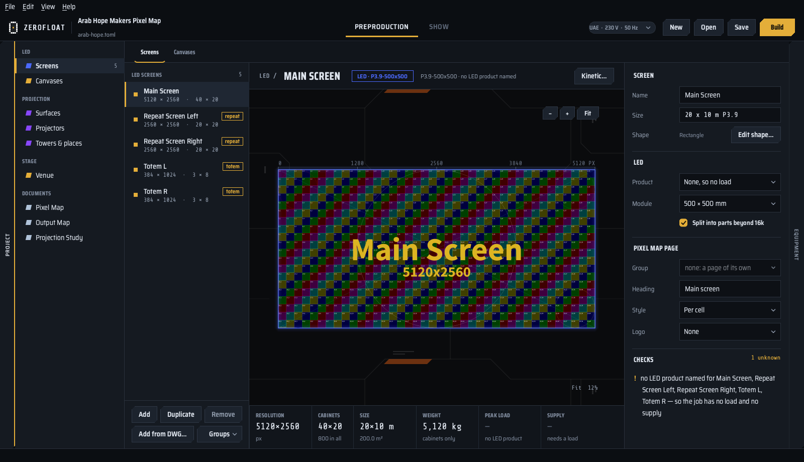

- **Preproduction | Show** at the top switches between the two halves. Each has its own pages, listed in the tree on
  the left:
  - Preproduction: LED, Projection, Stage, Documents.
  - Show: Files and Playback.
- **The Navigator** on the left (⌘0 shows or hides it) lists the pages and how many things each holds. Click a row to
  open its page.
- **The mains badge** (for example *230 V · 50 Hz*) sets the mains voltage and frequency of the job: click it (or use
  Edit › Mains…) and type the voltage, 50 to 1000 V, and choose 50 or 60 Hz. These decide the current drawn and the
  default frame rate: 50 Hz gives 25/50 fps, 60 Hz gives 30/60 fps.
- **New, Open, Save, Build** are on the right. Build is Preproduction's only.
- **The equipment panel** (⌘E, or the *Equipment* tab on the right edge) lists the job's kit beside any page:
  - the machines and the LED;
  - the projectors, lenses and towers;
  - the power;
  - what could not be counted.

  It follows every change a moment later.
- **The status bar** at the bottom says what the program is doing and what a job left out.

**The mouse wheel** turns a number or a list only in the field that has the focus; over any other it scrolls the page.
**Help › What's New** lists what changed in each version, and it is shown once by itself after an update.

**Every page has the same three columns**: a list on the left with *Add · Duplicate · Remove* at its foot, the picture
in the middle with tiles of figures under it, and the inspector on the right with the fields and the **Checks**. A
check marked **!** is something you should look at; it never stops you working.

**Undo** (⌘Z) and **Redo** (⇧⌘Z) take back any change to the project, the canvas drag included.

---

## 3. Projects

A project is one file, `.zf` (TOML inside, readable in any text editor). The window also opens the older `.toml`. When
you save such a project, it is written as a `.zf` beside the `.toml`, and never over an existing `.zf`.

- **File › New Project…** (⌘N) asks the title, the region and who drew it, and starts empty.
- **File › Open…** (⌘O) and **Open Recent**.
- **File › Project Settings…** (⌘,):
  - the title and *Title on documents*;
  - the project name and description printed in the footers;
  - *Drawn by* and the region;
  - **Media server**: disguise, Resolume Arena or Watchout. This decides the codec and link on the Content Delivery
    page;
  - the validation e-mail;
  - the project's own **Logo**.
- **File › Preferences…**: the logo and the line of copyright on every document you make. A project's own logo wins
  over it. With neither, the documents carry Zerofloat's mark and no copyright line.

Saving rewrites the file from what the program holds. Comments typed into the file by hand are not kept.

---

## 4. LED screens

*Preproduction › LED › Screens* (⌘1).

**Add** makes a screen. Its **Size** is three fields: the width and the height in metres, and the pitch (*3.9*).
In *Preferences* it can be one line instead, typed as a sentence the program reads:

```
20 x 10 m P3.9
6 x 3 m P2.6
```

The pitch is a *name* for a cabinet, looked up in the cabinet table. It is never used for arithmetic: P3.9 is 500 mm
and 128 px, so the real pitch is 3.90625 mm. **A size that is not a whole number of cabinets is refused**, with the
nearest sizes that would work. Nothing is rounded silently.

In the inspector:

| Field | What it does |
|---|---|
| **Name** | the screen's name on every page and in disguise |
| **Shape** | *Edit shape…* takes cabinets out of the rectangle, for an L, a cross or a screen with a hole |
| **Product** | the LED product (for example Gloshine F3). **Power comes only from the product**: with *None* the weight is still counted, and the load is left blank rather than guessed |
| **Module** | the cabinet size, when no product is chosen |
| **Split into parts beyond 16k** | a screen wider or taller than 16 384 px is delivered as several pictures |
| **Pixel Map page: Group, Heading, Style, Logo** | which page of the Pixel Map the screen is on, its heading, the grid's style (*Per cell*, *Checker* with an accent colour…) and whether the grid carries a logo |

The tiles under the picture give the resolution, the cabinets, the size, the weight, the peak load and the mains
supply.

**Several at once.** Shift-click or ⌘-click chooses several screens in the list. Drag them to put them in order.
*Groups* puts screens on one Pixel Map page. **Duplicate** (⌘D) copies the chosen screen.

**Add from DWG…** reads a Vectorworks drawing (DWG needs the ODA File Converter, see section 1). Every layer with 3D
faces becomes a row: name, cabinets across × up, size and module.

- Choose the LED product (or a pitch) for them all, tick the rows and **Add**.
- A row whose screen would not come out with the drawn cabinets is refused, with what it would come out as.
- **Mirror** turns a screen round, because a drawing does not say which face of a box is the front.
- **Into** gives the drawing's position to a screen the project already has.

A screen read from a drawing keeps where it stands, and the Stage page and the disguise build use that position.

**Kinetic…** (over the picture) makes a looping movie of the screen's grid whose cabinets breathe. Use it to check a
real LED wall for tearing and for each cabinet's mapping.

- The wave can come from the centre, run across or down, or be random.
- You choose the breath, the depth, the length and the *Wavelength* in cabinet widths.
- The format is Hap Q, Hap Alpha, DXV 2 or a PNG sequence.

A cabinet's pixels are never moved or scaled, so thin lines stay sharp. Several screens chosen together are rendered
in one go. The clips go to the job line; they do not stop you working.

---

## 5. LED canvases

*Preproduction › LED › Canvases*.

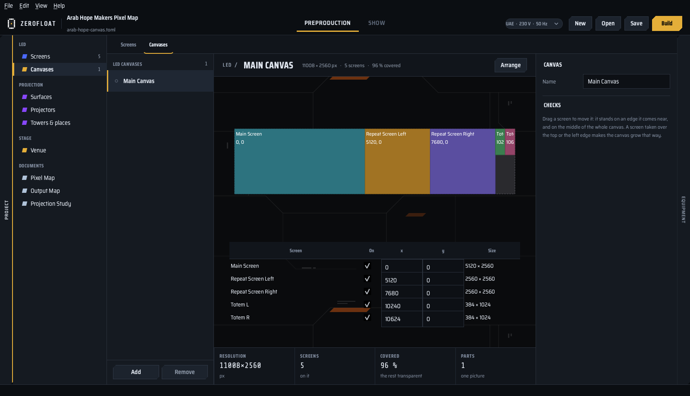

A canvas is one picture at one resolution with several screens standing on it, as a media server is often fed.

1. **Add** a canvas and tick the screens that stand on it, or **Add group** to put every screen of a group on it at
   once. A screen may stand on several canvases.
2. **Arrange** lays them out in the least area, never wider than 16 384 px.
3. To place a screen yourself, drag it in the picture, or type its **x** and **y**. Each screen is drawn as its panels
   (a shape's missing panels left empty), and a dragged screen snaps to the edges near it, to another screen's panel
   joints and to the middle of the whole canvas.

The canvas's size follows from the screens, and it begins where they do: its left edge is the leftmost screen's and its
top the topmost screen's, so there is no empty strip beside or above them. Screens that overlap are refused (two shaped screens may nest where their
panels do not meet), and empty places are transparent. The
canvas becomes an extra page of the Pixel Map. It takes no part in the Output Map or the equipment list.

---

## 6. Projection

*Preproduction › Projection* (⌘2) has three pages: **Surfaces**, **Projectors** and **Towers & places**. The first
time it is opened it asks whether there is a **Mapping Matter export**. Answer *Import from Mapping Matter…*, or *No,
add by hand*.

### Surfaces

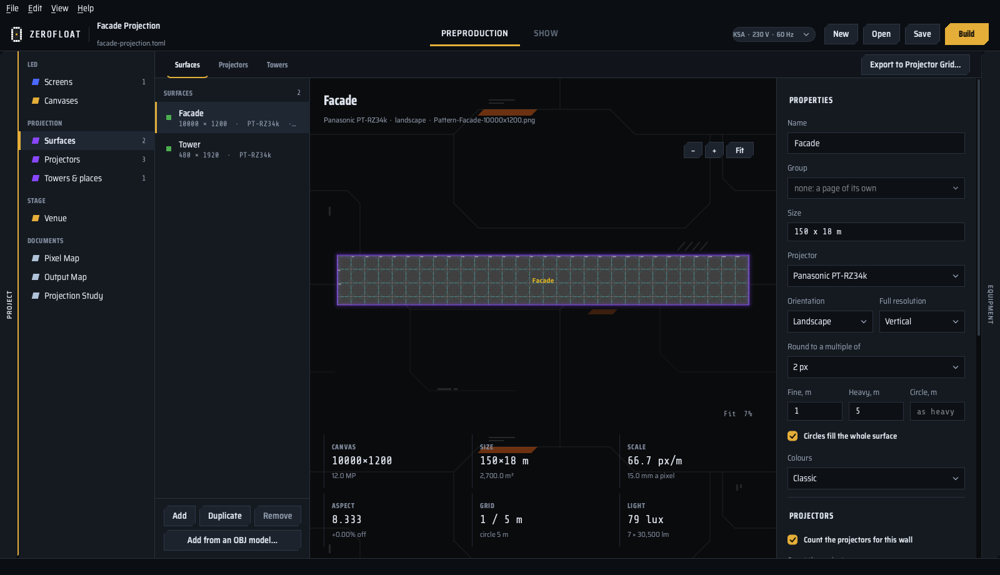

A **flat wall** is a size in metres and a projector, typed as an LED screen is (`150 x 18 m`). Its canvas follows from
the projector's resolution and orientation.

- **Full resolution** and **Round to a multiple of** decide the pixel size.
- **Thin lines**, **Thick lines** (how far apart, in metres) and **Circles** (how wide) decide the metric test pattern.
  On a wall counted in parts, the Preview draws each projector's part on the pattern, numbered.

**Add from an OBJ model…** takes a 3D model instead. Its test grid is drawn on the model's own UV map.

**Count the projectors for this wall** tiles the wall with the chosen projector, with a 20 % blend by default:

- the count joins the equipment list, the signals and the power;
- the brightness comes out in **lux** (all the projectors' lumens over the area);
- a **lens** gives the distance, and a **distance** gives the lens whose range holds it;
- **Stack** puts two or three projectors on each position. That raises the light and the power but not the signals.

A picture beyond 16 384 px is either scaled to fit or cut into parts.

### Projectors

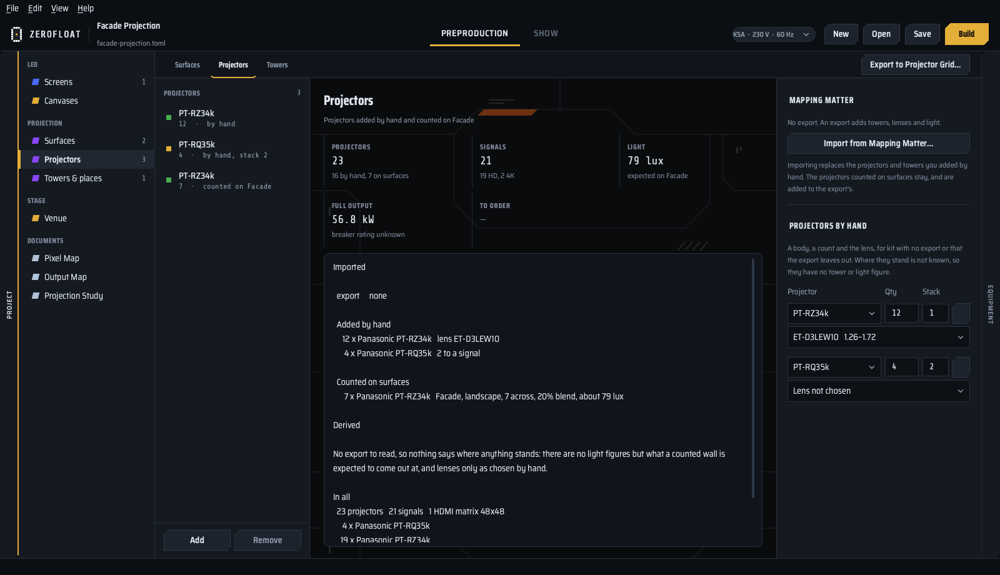

- **Import from Mapping Matter…** (⇧⌘I) reads an export: the projectors, the lenses, where each stands and the light
  on target. Importing replaces the projectors and towers added by hand; the projectors counted on walls stay and are
  added to the export's.
- **Projectors by hand**: a body, a count, a stack and a lens, for kit with no export.
- The tiles give the projectors, the signals, the light and the full output in kW.

### Towers & places

The export's positions are grouped into **places**: a tower (scaffolding), a rooftop or the ground. They are found by
distance (4 m), and you can change that by hand:

- move positions between places, or split a place into one per position;
- reorder the places;
- give each place its size, its console number and its supply.

Each place gets a page in the Projection Study, with a screenshot or a map view.

**Export to Projector Grid…** (at the top right) writes a `.pgrid` file for the Projector Grid app:

- one node for every physical projector;
- the towers as groups;
- IP addresses from the subnet you give.

A login and password are typed for that one file and never saved in the project.

---

## 7. Stage and the disguise build

*Preproduction › Stage › Venue* (⌘7) shows the whole job in 3D, exactly where the disguise build will put it:

- the LED screens and walls where the drawing places them;
- the models;
- the export's projectors with the pyramid of their light.

To move around: drag to turn, scroll to come nearer, drag with the middle button (or Shift on the floor) to look
sideways, double-click a thing to go to it. *Front*, *Top* and *Whole venue* set the view.

To change the chosen thing, use its **gizmo**. It has two modes, chosen by *Move* and *Rotate* under the picture (or the
keys W and E): in *Move* drag a red, green or blue **arrow** to move it along disguise's X, Y or Z; in *Rotate* drag a
**ring** to turn it about that axis (Shift: in steps of 10 cm and 15°). The gizmo is as big on the picture as the thing
is, between a small and a large size, so it grows smaller as you draw away. Dragging the thing itself still moves
it on its level (Shift up and down, Option turns it). Its X, Y, Z and the three turns are in the inspector.

What stands nowhere (a screen added by hand, a projector by hand) is drawn in a row on the floor, in rust colour. The
screens can show their test pattern or the content placed for them.

**Build disguise project…** (the Stage page's inspector, under *disguise*) builds the screens, surfaces and projectors
in the project open in a running Designer, through its Python API.

- Each LED screen's grid goes in as a one-frame Hap Alpha movie, laid on its screen.
- *Check* lists what it would do with a tick for each thing: untick what is not to go into disguise; its grid, test
  pattern and layer stay out with it.
- Name the Designer machine there (on Windows it is this computer, *localhost*, unless the project names another).
- The disguise project is the one chosen on the Files page (section 9).

---

## 8. Documents and Build

*Preproduction › Documents* (⌘3) shows the three PDFs as a build will write them, drawn from the project as it is now.

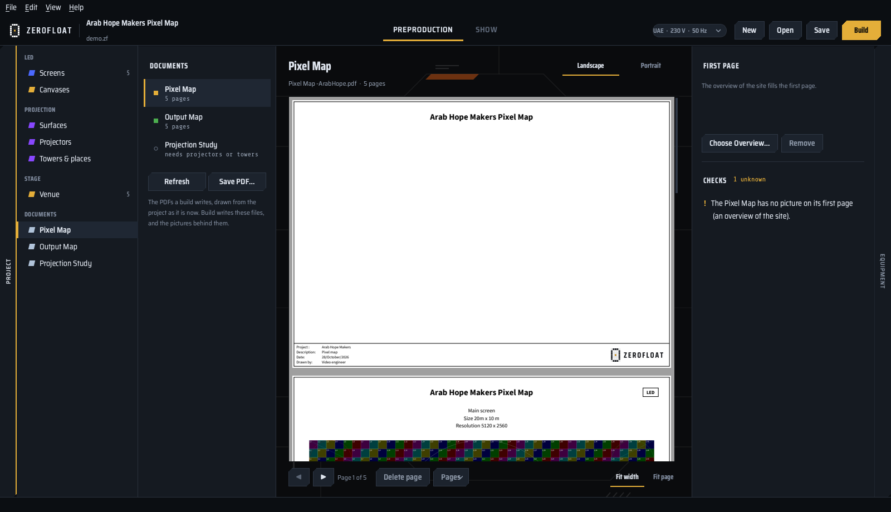

| Document | For | What it holds |
|---|---|---|
| **Pixel Map** | the client and the content makers | a cover, a page for each LED screen and projection surface, the canvases, and the **Content Delivery Specification** as its last page |
| **Output Map** | the crew | how the LED is patched: which output of which server feeds which piece of which screen, then every output as its frame, four to a page, with rulers in pixels |
| **Projection Study** | the crew and the client | the projectors, the lenses, the light, the towers and the power plan |

- **Landscape / Portrait** decide how the pages stand. Both are A3.
- **Choose Overview…** puts a picture of the site on the first page.
- **Delete page** removes a page from a document.
- **Save PDF…** saves the one shown.

**Build** (⌘B, the gold button) asks what to write and where:

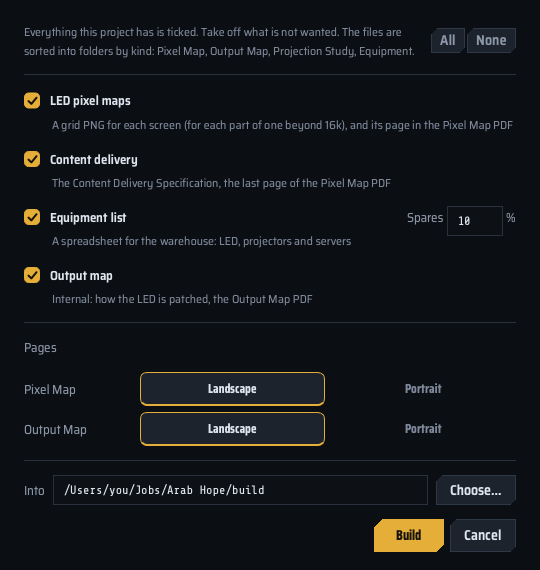

```
build/
  Pixel Map/          <name> Pixel Map.pdf, Pixel Grids/, Test Patterns/
  Output Map/         <name> Output Map.pdf
  Projection Study/   <name> Projection Study.pdf
  Equipment/          <name> - Equipment.xlsx and .csv
```

**A build never writes over a PDF.** The next one is `<name>_v2.pdf`, then `_v3`. When a folder already holds a
build, *Only the PDFs that changed* leaves the unchanged ones alone.

Grid and pattern pictures keep their names, because a media server finds them by name. They are rewritten only when
their pixels changed.

**The equipment list** is one workbook: the servers and the signals they are counted from, the LED, the projection
(projectors, lenses, towers, scaffolding) and the electrics, with the spares you ask for.

---

## 9. Incoming: content into the show

*Show › Files › Incoming* (⌘4).

**The first time** the Show half is opened on a project, it asks for two folders. Both can be changed later on this
page.

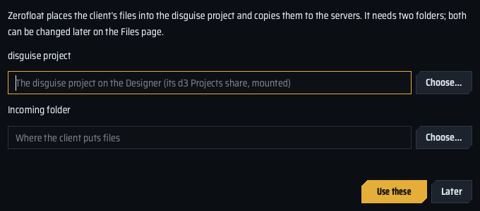

- **The disguise project**: the folder on the Designer that holds the `.d3` and `objects/`, reached through its
  `d3 Projects` share mounted on this Mac.
- **The incoming folder**: where the client puts files. Usually on this Mac.

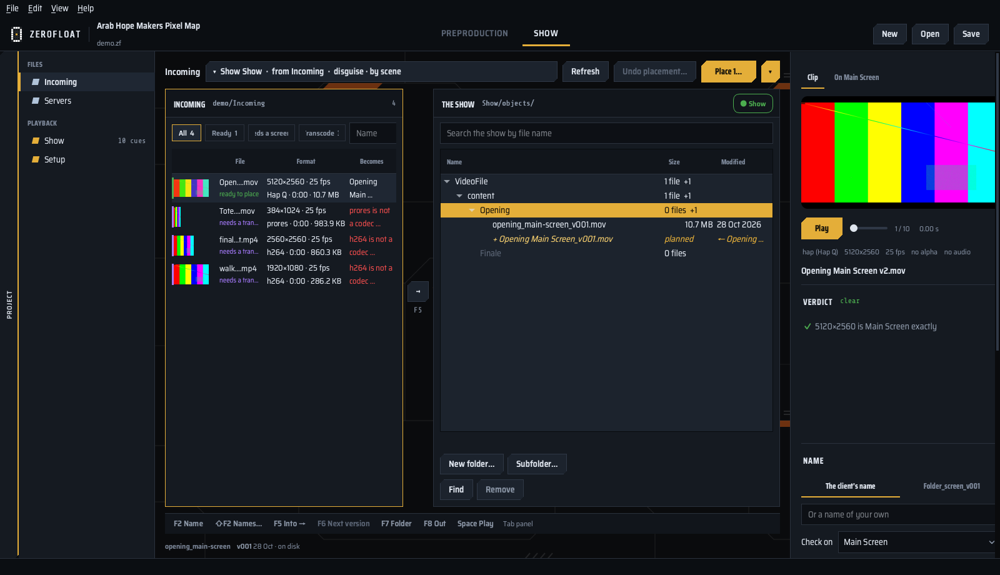

**Two panels.**

- **Incoming** on the left: what arrived. Each row shows a thumbnail, the format, and what the file becomes.
- **The show** on the right: the disguise project's own folders under `objects/`, as a tree. The pill at the top
  right says whether the share can be placed into: green, amber while it is read, red when it cannot.

The panel with the keyboard is framed in gold, and **Tab** moves between them.

**What each row says.**

| State | Meaning |
|---|---|
| **ready to place** | disguise plays it, and it knows its screen |
| **needs a screen** | the name did not say which screen; choose it in the inspector |
| **needs a transcode** | disguise will not play it (H.264, ProRes, a NotchLC file whose frames change between alpha and none…) |

The inspector on the right plays the file (**Space**) and gives the **Verdict**: for example, it fits its screen
exactly, or it would be scaled. It also sets **Name** (*the client's name*, or the convention
`<scene>_<screen>_v001`), the screen it is checked on, and the clip type disguise should give it (Fit, Stretch, Pixel
perfect…).

**Putting files where they go.**

- Drag rows onto a folder of the show, or choose a folder and press **→** or **F5**.
- Drag a row onto a file of the show to make it **that file's next version**: it takes that file's name, one version
  higher. **F6** does the same.
- What Place would add is drawn in **gold** in its folder (`+ name`, *planned*).

| Key | Does |
|---|---|
| **F2** | a name of your own for the file |
| **⇧F2** | names for many files by a pattern: `[N]` the file's name, `[C]` a counter, find and replace, case |
| **F5** | into the folder chosen on the right |
| **F6** | the next version of the file chosen on the right |
| **F7** | a new folder in the show |
| **F8** | leave the file out (or take it back in) |
| **Space** | play or pause |

**Place…** shows every copy before anything is written. Then:

1. A file disguise cannot play is **transcoded first**:
   - Hap Q by default, or Hap Alpha for a picture or a source with alpha;
   - Hap, Hap Alpha or DXV 2 if you choose;
   - its sound goes to a WAV in `AudioFile/`, stays inside the movie, or is left out (*No sound*), as the transcode
     settings say; the player's own transcode has a *No sound* box too.
2. Every copy is checked against its source.
3. A file already in the show is left out.
4. The client's file is moved into `Placed/` inside the incoming folder. **A source is never deleted.**

Place's arrow offers more:

- **Place, then copy to the servers…**: the copy of section 10 follows straight after.
- **Undo placement…** walks the last placement back. A file changed since is kept.
- **Purge this Mac's copy…**: with *Keep a copy on this Mac* ticked, the placed files are kept here too. Purge removes
  them only once the Designer and **every** server hold the same file at the same size.

**The folder template** (left rail) decides the layout of `content/` and the names: *disguise · by scene*, *by screen*,
*by scene and screen*, *flat*, *by delivery date*. **Folders in Content…** previews the folders and makes them.

**Nothing in the show is ever renamed.** Only the arriving file is named, as it enters.

---

## 10. Servers: the copy to every machine

*Show › Files › Servers* (⌘8).

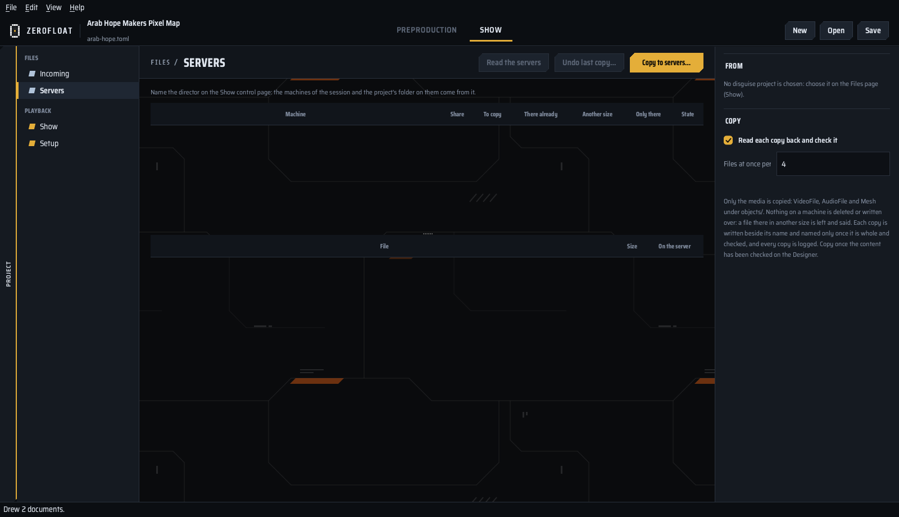

The director must be named on the Setup page first (section 12).

**Read the servers** asks the director which machines the session has and where the project is on them. It then opens
each machine's `d3 Projects` share as a guest and lists, for each machine:

- what would be copied (*To copy*);
- what is there already;
- what is there in *Another size*;
- what *Only* that machine has.

**Copy to servers…** shows a summary and then copies to every machine at once.

- Only the media is copied: `VideoFile`, `AudioFile` and `Mesh` under `objects/`.
- **Nothing on a machine is deleted or written over.** A file there in another size is left and named for you to look
  at.
- Each copy is written under a temporary name and renamed only when it is whole and checked. With *Read each copy
  back and check it* on, it is read back too.
- Each machine's free space is checked before the copy starts.
- *Files at once per machine* (1 to 6) sets the speed. 4 suits a 10 Gbit network. A machine is written the next file
  while the last one is read back.
- **Speed test** (under *Network*, once the servers are read) writes 1 GB to each machine, reads it back and removes
  it, and says how fast each link is both ways.

**Undo last copy…** removes what the last copy wrote, if it is unchanged. **Remove leftover parts…** clears pieces an
interrupted copy left.

Copy once the content has been checked on the Designer.

---

## 11. Show: cues and GO

*Show › Playback › Show* (⌘5). This is the page to look at during the show.

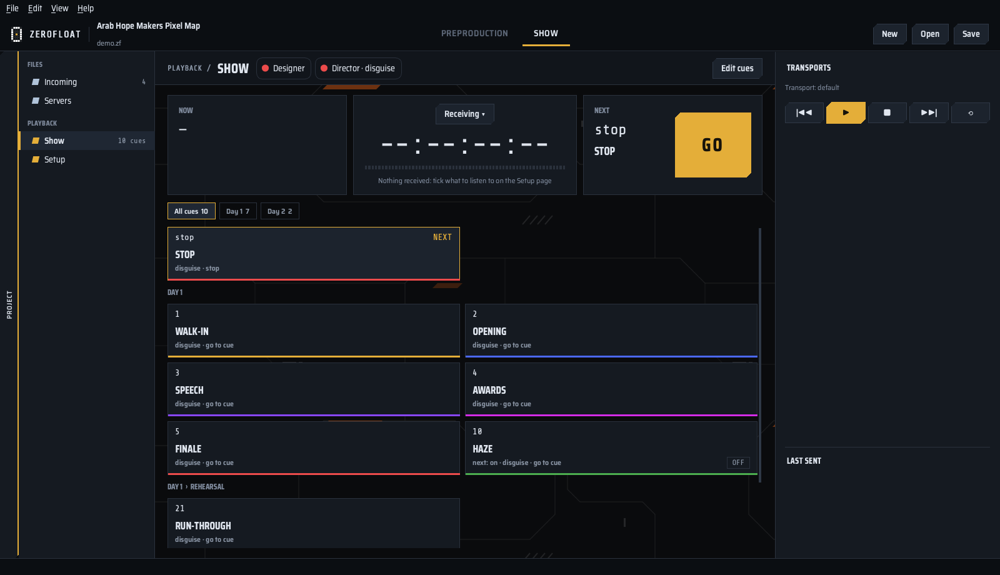

- **The lights** at the top: one for the Designer and one for the director. Green answers within 4 s, amber within 10,
  red after.
- **NOW · the clock · NEXT · GO.**
  - **GO** (or **Space**) sends the next cue.
  - The clock shows the timecode received or the timecode this program generates; the button over it chooses which.
- **The cues** fill the page: NOW is gold, NEXT is outlined. Click a cue to send it.
- **Transports** on the right: a card for each transport disguise has, with its track, section, mode and position, and
  its buttons: previous section, play, stop, next section, return to start.
  - The **star** on a card makes the big countdown follow that transport.
  - **Hide** takes a card out of sight.
- **Last sent** lists what went, and what came back.

**A cue moves the show on only once it has gone.** If disguise refuses it, the reason is said and NEXT stays where it
was.

**Groups.** The cues are kept in groups, up to four deep (for example *Day 1 › Evening › Concert*).

- The line over the cues picks the group shown; *All cues* shows everything.
- **GO goes through the group shown and stops at its end.** It never runs on into the next group; start that group by
  pressing its first cue.
- A **pinned** group is shown over the others whatever group is open, in a blue frame. Its cues are pressed by hand and
  do not move GO.
- The **+** at the end of a line of groups adds a group there. Drag a group onto another to put it inside it, or onto
  *All cues* to bring it back to the top.

**The countdown** on the right says the section playing now (*NOW: …*), what comes next on the track and, when a video
layer plays, how long until the end of that video.

**Lock cues** (beside *Edit cues*): while it is on, a click, GO, the Buttons module and OSC send nothing; what was
pressed is written in the log. If the window ever hangs, a press in Buttons is still sent.

**A latch** is a cue with two halves, ON and OFF (for example haze on and haze off). Each press sends the other half.

**Edit cues** turns the page into an editor. A click then edits a cue instead of sending it:

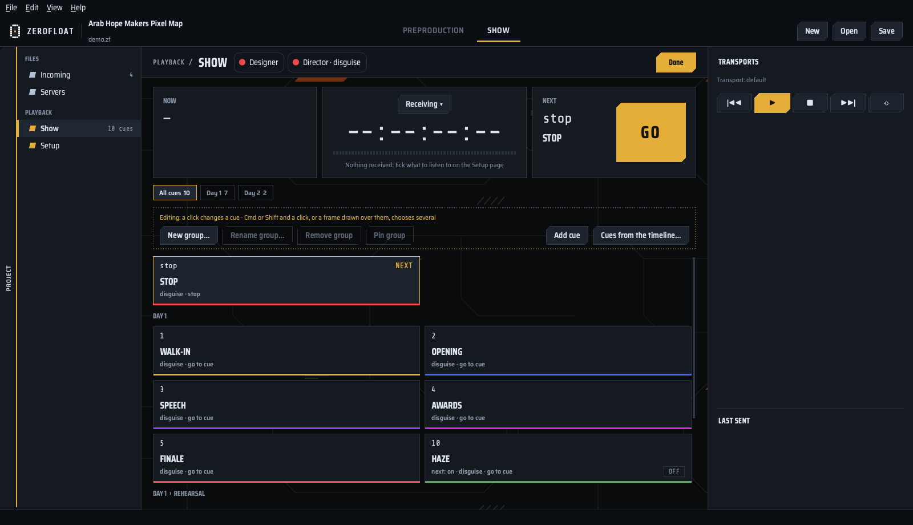

- **Add cue**: a disguise cue number, or a transport command:
  - play, play section, loop, stop, return to start, next or previous section;
  - go to a time, a timecode or a track;
  - brightness, volume.

  Choose its destination and colour (a row of swatches), and its second half if it is a latch. A new destination is
  disguise's Session API or a TimeCore; OSC and MultiTransport destinations of older projects still work.
- **Cues from the timeline…**: a tree of transport › track › CUE tag, read from disguise. Tick what you want, and one
  cue is made for each tag.
- **New group…, Rename group…, Remove group, Pin group.**
- ⌘-click and Shift-click choose several cues, or draw a frame over them. Then **Move N cues to group** or **Remove N
  cues** (Delete). ⌘Z puts them back.

Press **Done** to go back to the show.

---

## 12. Setup: what the show talks to

*Show › Playback › Setup* (⌘6). Set once a job.

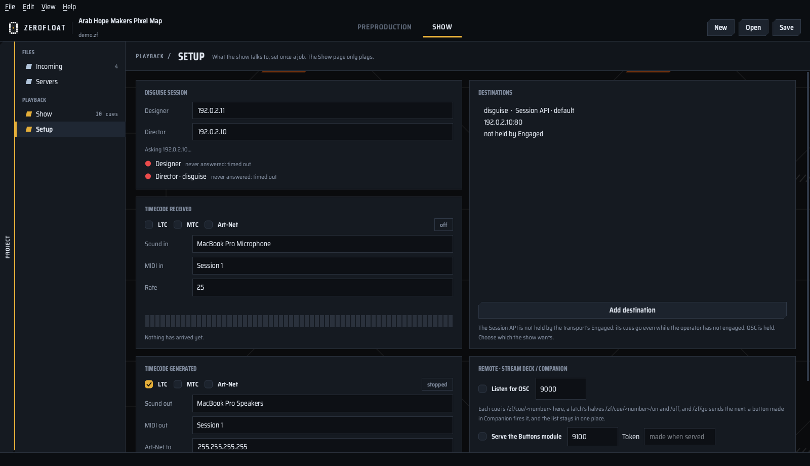

**disguise session.**

- **Designer** is the editor machine: the files and the project.
- **Director** is the machine that runs the show: the live commands, the transports and the Live Update.

The lights under them say whether each answers.

**Destinations** are where cues go. **Add destination** offers four kinds:

| Kind | Note |
|---|---|
| **Session API** | disguise's own HTTP API on the director, port 80. Answers each cue, so a refusal comes back with its reason. **Not held by the transport's Engaged**: its cues go even while the operator has not engaged |
| **OSC** | to an OSC device in the disguise project. Ignored by disguise until the transport is engaged |
| **MultiTransport** | disguise's MultiTransport Manager |
| **TimeCore** | a Visual Productions TimeCore: start, pause, stop, restart, set its clock |

**Timecode received.** Tick **LTC** (a sound input), **MTC** (a MIDI input, network MIDI included) or **Art-Net**, and
choose the rate. The bar shows whether it runs steadily. Two sources ticked are a clock each, and the Show page's clock
button chooses which one is shown.

**Timecode generated.** Tick LTC, MTC or Art-Net, choose the outputs and *Start at*. Start, Stop and Go to are under
the clock on the Show page while it generates.

On Windows MIDI is not reached yet: MTC is switched off there, and timecode goes as LTC or Art-Net.

**Remote: Stream Deck / Companion.**

- **Listen for OSC** (port 9000): `/zf/cue/<number>` sends a cue, `/zf/cue/<number>/on` and `/off` the halves of a
  latch, and `/zf/go` sends the next.
- **Serve the Buttons module** (port 9100) with its **Token**: see section 13.

---

## 13. Bitfocus Buttons and Companion

The DMG's `Buttons module/zerofloat` is a module for Bitfocus Buttons and Companion. With it, the show's cues become
buttons that stay in step with the Show page.

1. In Zerofloat: *Setup › Remote*, tick **Serve the Buttons module**. Copy the **Token** beside it.
2. In Buttons: *Settings › Developer*, import the `zerofloat` folder as a module, and add a connection of it.
3. In the connection, type the Mac's address, the port (9100) and the **Token**. A connection without the token is
   refused.

**Presets.** Each group of cues is a category of presets.

- With the connection's *Preset Mode* on **Popover**, a group dragged onto a position becomes one button that opens
  over the others with its cues.
- *GO and transport* has GO (with the next cue's name), NOW, the countdown and the transport buttons.

**Lights.** NOW is gold, NEXT is gold text, a latch that is ON is green, and a cue whose destination is missing is
red. A cue's button has the cue's colour and its name, and both change on the button when they change in Zerofloat
(module 1.1.0: import it again after updating).

**Variables.** `now`, `next`, `countdown`, `section`, `group`, the same for each transport, and for each cue
`cue_<number>_name` and `cue_<number>_countdown` (cue 1.2 is `cue_1_2`).

When cues are added in Zerofloat, drag the group onto the buttons again. A press on a button is a press on the Show
page.

---

## 14. Updates

About half a minute after the program starts, and every six hours after that, Zerofloat looks for a new version. You
can also check yourself with *Help › Check for Updates…*.

1. A new version downloads in the background.
2. Its signature and checksum are checked.
3. A bar offers **Restart now** or **Later**. *Later* installs it when you quit.

**An update is never installed during a show.** It waits while a transport is playing, timecode is going out, or a
placement, a copy to the servers, a transcode, a build or a render is running.

*Help › About Zerofloat* shows the version, the build and when the last check was made.

---

## 15. Keyboard shortcuts

As a Mac writes them; on Windows **Ctrl** stands for **⌘** and **Shift** for **⇧** (Ctrl+N, Ctrl+Shift+S, …).

| Keys | Does |
|---|---|
| ⌘N / ⌘O / ⌘S / ⇧⌘S | New, Open, Save, Save As |
| ⌘B | Build |
| ⌘, | Project Settings |
| ⇧⌘I | Import from Mapping Matter |
| ⇧⌘O | Add files to Incoming |
| ⌘Z / ⇧⌘Z | Undo / Redo |
| ⌘D | Duplicate the chosen screen or surface |
| ⌘1 … ⌘8 | LED, Projection, Documents, Files, Show, Setup, Stage, Servers |
| ⌘0 | the project tree |
| ⌘E | the equipment panel |
| Space | GO on the Show page; play or pause in Incoming |
| F2, ⇧F2, F5, F6, F7, F8, Tab | Incoming (section 9) |

---

## 16. When something goes wrong

- **"Zerofloat cannot be opened because the developer cannot be verified"** (Mac) or **"Windows protected your
  PC"** (Windows). See the first opening in section 1.
- **A DWG does not open.** Install the ODA File Converter (section 1).
- **The show's pill is red, or Place is refused.** The disguise project's share is not reached or cannot be written
  to. On a Mac, mount `d3 Projects` from the Designer in Finder; on Windows, open `\\<designer>\d3 Projects` in
  Explorer. Then choose the project folder again on the Files page.
- **A file is "needs a transcode".** disguise does not play it. Place transcodes it into Hap; you do not have to do it
  elsewhere.
- **"Resource busy" while placing.** disguise is reading the file that was just put there. The program waits for it,
  up to three minutes.
- **The lights on Setup are red.** The address is wrong, the machine is off, or this computer is on another network. The
  Session API answers on port 80 of the director.
- **A cue is drawn with *no destination* in red.** The destination it names was removed. Edit the cue and choose
  another.
- **Feedback.** Tell the person who gave you the program, with the version from *Help › About Zerofloat* and what you
  did. Never send a client's project or content.
