# Zerofloat — User Manual

Version 0.2.0 · macOS (Apple silicon) and Windows (x64)

Zerofloat is a tool for the video engineer of a live event. It has two halves:

- **Preproduction**: the LED screens and projection surfaces of a job, and the documents made from them: the Pixel
  Map, the Output Map, the Projection Study and the equipment list. It can also build the job's screens in a disguise
  project.
- **Show**: the client's content as it arrives, placed into the disguise project and copied to every server. Cues are
  sent to disguise from a page of big buttons, and timecode is read and generated.

The program never guesses where it is unsure. A screen that is not a whole number of cabinets, a file disguise
cannot play, or a copy that differs from its source is refused, and the program says why. It never writes over or
deletes a file in the show.

---

## Contents

1. [Install and first opening](#1-install-and-first-opening)
2. [The window](#2-the-window)
3. [Projects](#3-projects)
4. [LED screens](#4-led-screens)
5. [LED canvases](#5-led-canvases)
6. [Projection](#6-projection)
7. [Stage and the disguise build](#7-stage-and-the-disguise-build)
8. [Documents and Build](#8-documents-and-build) (and Content check)
9. [Incoming: content into the show](#9-incoming-content-into-the-show)
10. [Delivery: the copy to every machine](#10-delivery-the-copy-to-every-machine) and [Machines](#10a-machines-the-disguise-machines-on-the-network)
    - [10a. Timeline: the running order](#10a-timeline-the-running-order)
11. [Show: cues and GO](#11-show-cues-and-go)
12. [Setup: what the show talks to](#12-setup-what-the-show-talks-to)
13. [Bitfocus Buttons and Companion](#13-bitfocus-buttons-and-companion)
14. [Updates](#14-updates)
15. [Keyboard shortcuts](#15-keyboard-shortcuts)
16. [When something goes wrong](#16-when-something-goes-wrong)

---

## 1. Install and first opening

The release is at <https://github.com/tjaY-k/zerofloat-releases/releases>. The pictures in this manual are of the
Mac; the Windows window is the same, with **Ctrl** where a Mac has **⌘** and **Alt** for **Option**.

### On a Mac

Download `Zerofloat-<version>.dmg` and open it. It holds:

| Item | What it is |
|---|---|
| **Zerofloat** | the application |
| **Applications** | a shortcut: drag Zerofloat onto it |
| **Buttons module/zerofloat** | the module for Bitfocus Buttons or Companion ([section 13](#13-bitfocus-buttons-and-companion)) |
| **Read me first.txt** | the first opening, in English and Russian |
| **Zerofloat Manual.html** | this manual, to open in any browser |

**The first opening.** This test version is not signed by Apple. The first time, macOS says it cannot check the
developer. There are two ways past it, and you only need to do this once:

- Right-click Zerofloat in Applications and choose **Open**, then **Open** again; or
- open it once, then go to **System Settings › Privacy & Security** and click **Open Anyway** beside Zerofloat.

### On Windows

Download `Zerofloat-<version>-win-x64.zip`, unpack it anywhere and open **Install Zerofloat.cmd** in the folder
`Zerofloat`: it copies the program to your own programs folder (`%LOCALAPPDATA%\Programs\Zerofloat`, no administrator
asked), puts Zerofloat in the Start menu and on the desktop, and starts it. Or keep the unpacked folder where you like —
**not** in Program Files: an update replaces this folder, and Program Files would ask an administrator each time. The
folder holds `zf.exe` (the program), `zf-console.exe` (the command line), the Buttons module, *Read me first.txt* and
this manual.

**The first opening.** This test version is not signed. The first time, Windows says *Windows protected your PC*:
click **More info**, then **Run anyway**. Only once.

### Both

**What the program needs.** ffmpeg is inside the application: it reads every common format and writes Hap, Hap Q and
Hap Alpha. Two things are optional:

- **ODA File Converter** (free, from the Open Design Alliance), installed where its installer puts it
  (`/Applications` on a Mac, `Program Files\ODA` on Windows). Without it a DWG drawing cannot be read; a DXF can.
- **A network that reaches disguise.** Designer's Python API and Session API answer on port 80, and the servers'
  `d3 Projects` shares are reached as a guest.

**Settings** are kept in `~/Library/Application Support/Zerofloat` on a Mac and in `%APPDATA%\Zerofloat` on Windows. The program's cache (thumbnails, transcodes,
logs of each placement) is the machine's own; nothing is written beside a project file.

---

## 2. The window

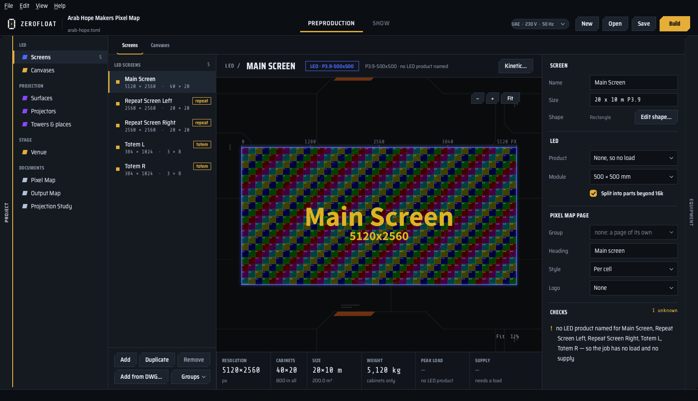

- **Preproduction | Show** at the top switches between the two halves. Each has its own pages, listed in the tree on
  the left:
  - Preproduction: LED, Projection, Stage, Documents, Content check.
  - Show: Files and Playback.
- **The Navigator** on the left (⌘0 shows or hides it) lists the pages and how many things each holds. Click a row to
  open its page.
- **The mains badge** (for example *230 V · 50 Hz*) sets the mains voltage and frequency of the job: click it (or use
  Edit › Mains…) and type the voltage, 50 to 1000 V, and choose 50 or 60 Hz. These decide the current drawn and the
  default frame rate: 50 Hz gives 25/50 fps, 60 Hz gives 30/60 fps.
- **New, Open, Save, Build** are on the right. Build is Preproduction's only.
- **The equipment panel** (⌘E, or the *Equipment* tab on the right edge) lists the job's kit beside any page:
  - the machines and the LED;
  - the projectors, lenses and towers;
  - the power;
  - what could not be counted.

  It follows every change a moment later. Two ticks at its top say how the disguise machines are counted, both on
  in a new project: *Dedicated director* (untick it when the director is one of the actors and outputs signals
  too: one of the output servers is then listed as *director (non-dedicated)* with its cards, and the actors are one
  fewer) and *Understudies* (untick it for none; ticked, one for every three
  actors built alike). The project keeps them, and the equipment list, the Output Map and the study count the same way.
- **The status bar** at the bottom says what the program is doing and what a job left out.

**The mouse wheel** turns a number or a list only in the field that has the focus; over any other it scrolls the page.
**Help › What's New** lists what changed in each version, and it is shown once by itself after an update.

**Every page has the same three columns**: a list on the left with *Add · Duplicate · Remove* at its foot, the picture
in the middle with tiles of figures under it, and the inspector on the right with the fields and the **Checks**. A
check marked **!** is something you should look at; it never stops you working.

**Undo** (⌘Z) and **Redo** (⇧⌘Z) take back any change to the project, the canvas drag included.

---

## 3. Projects

A project is one file, `.zf` (TOML inside, readable in any text editor). The window also opens the older `.toml`. When
you save such a project, it is written as a `.zf` beside the `.toml`, and never over an existing `.zf`.

- **File › New Project…** (⌘N) asks the title, the region and who drew it, and starts empty. **Advanced Settings…**
  folds out every other field of Project Settings (below), so a project can be set up whole before it is made.
- **File › Open…** (⌘O) and **Open Recent**.
- **File › Project Settings…** (⇧⌘, on a Mac, Ctrl+, on Windows):
  - the title and *Title on documents*;
  - the project name and description printed in the footers;
  - *Drawn by* and the region;
  - **Media server**: disguise, Resolume Arena or Watchout. This decides the codec and link on the Content Delivery
    page;
  - the validation e-mail;
  - the project's own **Logo**.
- **Preferences…** (⌘, on a Mac, where it is in the *Zerofloat* menu; on Windows it is in *File*): what is the
  program's own, whatever the project:
  - the logo and the line of copyright on every document you make. A project's own logo wins over it. With neither,
    the documents carry Zerofloat's mark and no copyright line;
  - whether an LED screen's size is typed as one line;
  - **Look for a new version by itself**, on or off (*Help › Check for Updates…* works either way);
  - the **cache folder** the program keeps its thumbnails and transcodes in, with a button that shows it.

Saving rewrites the file from what the program holds. Comments typed into the file by hand are not kept.
Before it writes, the program reads the project back: if the file would not open again, *Cannot save* says why,
and the file on disk is left as it was. Put that right, or undo the last change, and save again.

---

## 4. LED screens

*Preproduction › LED › Screens* (⌘1).

**Add** makes a screen. Its **Size** is three fields: the width and the height in metres, and the pitch (*3.9*).
In *Preferences* it can be one line instead, typed as a sentence the program reads:

```
20 x 10 m P3.9
6 x 3 m P2.6
```

The pitch is a *name* for a cabinet, looked up in the cabinet table. It is never used for arithmetic: P3.9 is 500 mm
and 128 px, so the real pitch is 3.90625 mm. **A size that is not a whole number of cabinets is refused**, with the
nearest sizes that would work. Nothing is rounded silently.

In the inspector:

| Field | What it does |
|---|---|
| **Name** | the screen's name on every page and in disguise |
| **Shape** | *Edit shape…* takes cabinets out of the rectangle, for an L, a cross or a screen with a hole |
| **Product** | the LED product (for example Gloshine F3), listed under its manufacturer. **Power comes only from the product**: with *None* the weight is still counted, and the load is left blank rather than guessed |
| **Module** | the cabinet size, when no product is chosen |
| **Split into parts beyond 16k** | a screen wider or taller than 16 384 px is delivered as several pictures |
| **Pixel Map page: Group, Heading, Style, Logo** | which page of the Pixel Map the screen is on, its heading, the grid's style (*Per cell*, *Checker* with an accent colour…) and whether the grid carries a logo |

The tiles under the picture give the resolution, the cabinets, the size, the weight, the peak load and the mains
supply.

**Several at once.** Shift-click or ⌘-click chooses several screens in the list. Drag them to put them in order.
*Groups* puts screens on one Pixel Map page. **Duplicate** (⌘D) copies the chosen screens, **Remove** (Delete) takes
them away, each in one step, which is one Undo.

**Every list works this way** (Shift-click or ⌘-click; Ctrl on Windows): LED screens, LED and projection canvases,
surfaces, the projector lines, places, the cover pictures, the files of the Files tab and of the Content tab, and the render
queue. **Duplicate**, **Remove** and Delete act on all that are chosen, as one Undo. With several chosen the inspector says
*N chosen* and shows the fields they can share (for screens the LED product, style, split and group; for surfaces the group,
projector, orientation, full-resolution axis, multiple and *Count projectors*); where they differ it says so (*Several…*,
*mixed*, a dash), and what you set goes to all of them. A name, a size or a file stays each one's own and is greyed. **If one of
them cannot take the change** (a screen that would stop being a whole number of cabinets), nothing is changed and the one
that refused is named. A list that only chooses what is shown (the pages of the Documents tab, the machine on the Servers
tab) or whose rows are ticked (the dialogs *Add from DWG*, *Cues from the timeline*,
*Build in disguise*, *Kinetic*) chooses one at a time, or by ticks.

**Add from DWG…** reads a Vectorworks drawing (DWG needs the ODA File Converter, see section 1). Every layer with 3D
faces becomes a row: name, cabinets across × up, size and module.

- Choose the LED product (or a pitch) for them all, tick the rows and **Add**. The products are listed under their manufacturer.
- A row whose screen would not come out with the drawn cabinets is refused, with what it would come out as.
- **Mirror** turns a screen round, because a drawing does not say which face of a box is the front.
- **Into** gives the drawing's position to a screen the project already has.

A screen read from a drawing keeps where it stands, and the Stage page and the disguise build use that position.

**Kinetic…** (over the picture) makes a looping movie of the screen's grid whose cabinets breathe. Use it to check a
real LED wall for tearing and for each cabinet's mapping.

- The wave can come from the centre, run across or down, or be random.
- You choose the breath, the depth, the length and the *Wavelength* in cabinet widths.
- The format is Hap Q, Hap Alpha, DXV 2 or a PNG sequence.

A cabinet's pixels are never moved or scaled, so thin lines stay sharp. Several screens chosen together are rendered
in one go. The clips go to the job line; they do not stop you working.

---

## 5. LED canvases

*Preproduction › LED › Canvases*.

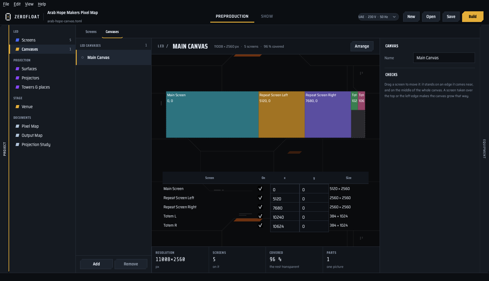

A canvas is one picture at one resolution with several screens standing on it, as a media server is often fed.

1. **Add** a canvas and tick the screens that stand on it, or **Add group** to put every screen of a group on it at
   once. A screen may stand on several canvases.
2. **Arrange** lays them out in the least area, never wider than 16 384 px.
3. To place a screen yourself, drag it in the picture, or type its **x** and **y**. Each screen is drawn as its panels
   (a shape's missing panels left empty), and a dragged screen snaps to the edges near it, to another screen's panel
   joints and to the middle of the whole canvas.
4. To move several screens together, choose them: **Shift-click** or **⌘-click** (Ctrl-click on Windows) adds a
   screen to the choice or takes it off, a drag over empty ground draws a band that chooses every screen it touches,
   and ⌘A chooses all. Dragging one of them, or the arrow keys (a pixel a press, ten with Shift), moves the whole
   choice; a drag is one step for Undo, and so is each press of an arrow.

The canvas's size follows from the screens, and it begins where they do: its left edge is the leftmost screen's and its
top the topmost screen's, so there is no empty strip beside or above them. Screens that overlap are refused (two shaped screens may nest where their
panels do not meet), and empty places are transparent. The
canvas becomes an extra page of the Pixel Map. It takes no part in the Output Map or the equipment list.

**Projection canvases** (*Preproduction › Projection › Canvases*) work the same way for walls: **Add** a canvas, tick the
surfaces that stand on it (a model a wall is linked to is that wall and is not listed), **Arrange** or drag them, type
**x** and **y**. The canvas is the smallest rectangle that holds the surfaces at the size their pictures are made at.
It becomes an extra page of the Pixel Map (the walls' test patterns put where they stand), content can be meant for it,
and in disguise it is a feed mapping onto the surfaces. `zf ledcanvas job.zf --name Walls --surface Facade --surface Side`
lays one out on the command line.

---

## 6. Projection

*Preproduction › Projection* (⌘2) has three pages: **Surfaces**, **Projectors** and **Places**. The first
time it is opened it asks whether there is a **Mapping Matter export**. Answer *Import from Mapping Matter…*, or *No,
add by hand*.

### Surfaces

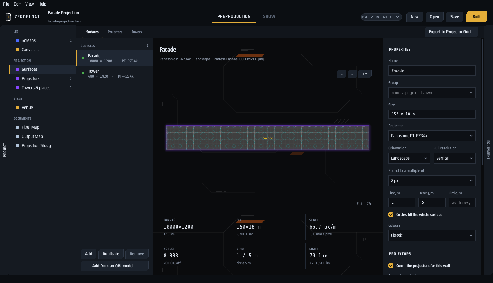

A **flat wall** is a size in metres and a projector, typed as an LED screen is (`150 x 18 m`). Its canvas follows from
the projector's resolution and orientation.

- **Full resolution** and **Round to a multiple of** decide the pixel size.
- **Thin lines**, **Thick lines** (how far apart, in metres) and **Circles** (how wide) decide the metric test pattern.
  On a wall counted in parts, the Preview draws each projector's part on the pattern, numbered.
- **Name the cells** letters the columns of the heavy grid along the top (A, B, … Z, AA …) and numbers the rows down
  the left edge, and writes each cell's own name (`C7`) small in its top right corner, as Vioso's calibration pattern
  does, so that a place on the wall can be called out over the radio. **Print resolution and size**
  puts the picture's pixels and its metres in the middle, under the name, as an LED grid says its resolution. Both are
  on for a wall added in the window, and off in a project that does not say so.
- **3D model** says which model of the project the wall stands for. **A model a wall is linked to *is* that wall:** it
  has no row of its own in the Surfaces list (the wall's inspector shows its OBJ, with **Change…**), no second page in the
  Pixel Map or the Projection Study, no second body on the Stage and no entry of its own where content is meant for a
  surface; in disguise it is one surface, the wall's, on the model's mesh (the OBJ is copied; the wall's pattern covers the
  whole map, stretched, as disguise spreads a picture over a surface). The wall's inspector has a **3D model** section for it: the
  **surface of the model** the pattern goes on, the **mask**, the **resolution of the map** (**read-only, «from the surface»**: a linked model is made at the wall's own canvas,
  e.g. 10800 x 2400, whatever size it had stored; over 16k it is scaled down as any map is, and the Checks say so; the size it had comes
  back if you unlink it; a mask must be that size too; the Checks warn when the unwrap is shaped unlike the canvas) and **Export UV pattern…** (the wall's pattern as the model shows it, on its unwrap), the same boxes the model has
  when it stands alone. A change there is made to the model and is one step of Undo. The model's name, group and its
  grid in pixels are not there: the pattern on it is the wall's. With several walls chosen the section is hidden. Pick **None**
  to let the model go: its row comes
  back, and with it its map, mask and surface of the OBJ to edit. The last line of the drop-down, **Add model…**, opens
  the file dialog, adds the model and links it to this wall. If the model is removed, the link stays and the Checks say
  so; renaming the model carries the link with it. The Checks say which wall a model stands for and warn when the
  unwrap does not fill the map, because the part of the pattern outside it is then lost. Several walls linked to one model
  are each a surface on its mesh. *(Older projects that list the model beside its wall open as they were; the model's
  row is simply hidden.)*
- **Export test pattern…** (the button, and *Export test pattern…* in the menu of a right click on the surface) writes
  the surface's pattern to a PNG you choose, starting in the folder Build writes the patterns to. A wall delivered in
  parts writes every part beside the file you choose. On a model it reads **Export UV pattern…**: the grid on the
  model's unwrap, transparent where the model is not.
- **Kinetic…** makes a looping movie of the wall's pattern whose heavy cells breathe, in the same window as the LED
  screens' kinetic movie: the cells come forward and sink back in a wave, and the circle in each cell breathes with it (full size
  when its cell is forward, smaller as it sinks back; *Depth* sets how much, 0 % keeps the circles still, and the wave,
  breath, wavelength and seed move them as they move the cells), while the metres, the names and the
  size stand still. It goes on the render queue; ask for Hap Q or a PNG sequence.

**Add from an OBJ model…** takes a 3D model instead (an **FBX** too: it is converted to an OBJ with the free `assimp` tool, once, into the program's own cache; the project keeps the FBX, and disguise gets the OBJ. Metres are made of the FBX's unit, the axes are kept. Textures the FBX embeds are taken out beside the OBJ in that cache, and the OBJ's material file names them; a texture that is only a path is copied from beside the FBX, and one nobody has is a note on the model's row, never a failure. Disguise gets the mesh alone: no picture and no material file is copied into `objects/Mesh/`. Without assimp (`brew install assimp`; `zf doctor` says) an FBX is refused with those words). Its test grid is drawn on the model's own UV map. A model with **no UV** (an OBJ with no `vt` lines, an FBX with no unwrap) is added all the same: it is listed, shown in the Venue and measured, but no pattern can be mapped onto it, so its pattern export, mask, grid and surface boxes are greyed out (hover for why), Build writes no pattern for it, and its Checks say that disguise needs a UV-mapped mesh to show content on it. Several OBJ or FBX
files can be chosen at once: each becomes a model (a mask goes with a single file only).

**Count the projectors for this wall** tiles the wall with the chosen projector, with a 20 % blend by default:

- the count joins the equipment list, the signals and the power;
- the brightness comes out in **lux** (all the projectors' lumens over the area);
- a **lens** gives the distance, and a **distance** gives the lens whose range holds it;
- **Stack** puts two or three projectors on each position. That raises the light and the power but not the signals.

A picture beyond 16 384 px is either scaled to fit or cut into parts.

**Curved surfaces: an arc or a cylinder.** **Shape** under Size makes a wall **Flat**, an **Arc** or a **Cylinder**. The
first time a wall is made curved the program asks **where the light comes from**: *Outside* (the projectors stand round
it and throw at the side that bulges to them) or *Inside* (they stand within its circle; inside a cylinder each is across
from its picture). *Cancel* keeps it flat. Then:

- **Size** is the **developed** width, the length along the curve, by the height: the canvas unrolled flat, as the pattern
  draws it. A cylinder's width is its circumference, 2πR, and the program writes it into Size for you.
- **Radius, m**; **Angle, °** for an arc (its width over its radius: typing the angle changes the width, typing the width
  changes the angle; changing the radius keeps the width, so the angle follows); **Seam, °** turns the canvas round the
  centre (nought puts its middle at the wall's place, and a cylinder's seam straight behind); **Light from** Outside or
  Inside.
- Above the picture, **Pattern / Top** switches between the test pattern and the wall **seen from above**: the circle, the
  canvas on it, and the counted projectors round it. Drag the **centre** (gold) towards or away from the wall for the
  radius, an **end** of an arc round for its angle, and a cylinder's **seam** round to turn it. The numbers in the
  inspector follow.
- **Counting** is as for a flat wall, on the developed width, with one more rule: the curve may turn the surface at most
  22.5° away from square at the edge of each projector's picture. So a picture spans at most **45°** of the circle lit
  from outside and **90°** lit from inside; where the flat count would make wider pictures, the wall is divided into
  more, smaller ones (more rows too where the height asks), and the count says *Divided by the curve*. Round a cylinder
  the pictures join, the seam blended like the rest: a drum of 5 m radius, 3 m high, lit from outside with PT-RZ34k
  needs 10 round and 2 high.
- In the **Venue** the counted projectors stand along the curve, each square to the middle of its picture: on a circle
  round it from outside; from inside, between the wall and its centre, or, inside a cylinder, across the diameter (with no
  lens or distance chosen, a metre short of the far wall). The Venue, the coverage rows of the study and the disguise
  build all use the same mesh, the curve in facets of 2°, with the pattern wrapped round it; in disguise it is a surface
  on its own OBJ. The study's Surface page says the shape: radius, angle, developed width, chord and depth of an arc, and
  the side the light comes from.

**How the export's projectors cover a surface.** When the job has a Mapping Matter export, each surface's page of the
Projection Study says how the export's projectors light it, as the Venue stands them:

- **Projectors**: the positions whose picture falls on the surface (a stack says how many it is);
- **Coverage**: how much of the surface at least one picture reaches, to within the share the page states;
- **Brightness**: the light on it in lux, on average and from the least to the most, where pictures overlap included.
  It counts each projector's lumens from the catalogue, the distance and the angle the light meets the surface at;
  it is left out, and the build notes say why, when it does not agree with the export's own figure for every position.

A projector that lights two surfaces is on both pages, and the notes say so; so do a position the export gives no
target, one that lights no surface of the job, and a wall that counts its own projectors to another number than the
export puts on it. A surface that reaches nothing says *No projector of the export reaches this surface*; one that
stands nowhere in the Venue (a wall with no place, in the row) cannot have the export laid on it and says that. A projector
added in the Venue is laid on the surfaces like the export's (it needs no export). A job with no projector that stands
anywhere has no such rows. On a 3D model only the faces its unwrap covers are measured
(the back and the edges of a screen with depth are not). Nothing in the way of the light is taken into account yet.

### Projectors

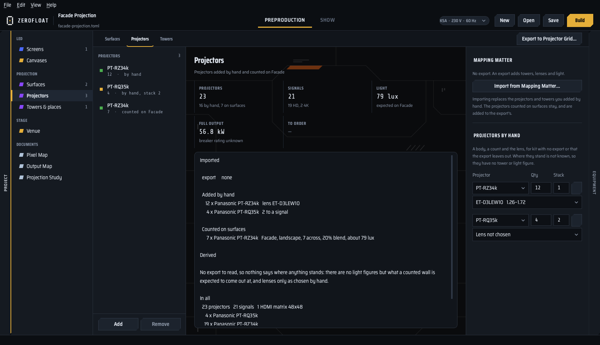

- **Import from Mapping Matter…** (⇧⌘I) reads an export: the projectors, the lenses, where each stands and the light
  on target. Importing replaces the projectors and towers added by hand; the projectors counted on walls stay and are
  added to the export's.
- **Which projector it is.** The export has no model column, so the program names the body from the resolution and
  the lumens of each row, out of every brand it knows: 1920 × 1200 at 13 000 lm is an Epson EB-PU2213B, 30 500 lm a
  Panasonic PT-RZ34K. The *Brand* box follows the bodies found, and *Projector* names one outright when the guess is
  wrong. A projector whose throw ratio no lens of its body serves is **kept**, with its throw, and the Lenses list says
  so ("no lens of the body serves …"); tick a lens in stock that the mount also takes to give it one.
- **Made on model** (shown when the project has a 3D model): the model this export was made on in Mapping Matter. Its
  projectors and what they aim at then follow that model: move or turn it on the Venue page and they go with it when you
  let go, there and in the disguise build (tick *Move screens already in the project* to move what is already in disguise).
  The list of towers and places and the study keep the export's own numbers. Left at *None*, the projectors stand as
  the export has them.
- **Power** is each model's own figure (Epson's and Panasonic's spec sheets). The PT-RZ34K has a breaker rating recorded
  from a delivered power plan. Any other body goes on the smallest single-phase line that holds its watts at the project's
  voltage, 16 A and then 32 A; *To order*, the feeds of a tower and the Power Plan page count from that, and each says it was
  sized from the watts. Above 32 A, or with no watts known, the breaker stays blank and the page says why.
- **Projectors by hand**: a body, a count, a stack and a lens, for kit with no export. Each row has a **Name** box; empty, the row is called by its model (and *×count*), as before.
- **Lenses in stock**: tick the lenses you have in the warehouse. The program **remembers the ticks on this computer**:
  an export brought into a project that has no stock of its own gets the lenses you ticked last time (those its
  projectors take), and a project that has none is offered them as a button, *Use the stock from last time*. A project
  that has its own stock keeps it.
- The tiles give the projectors, the signals, the light and the full output in kW.

### Places

The export's positions are grouped into **places**. A place is not one kind: it has **details**, any of a **Tower**
(scaffolding to order), a **Truss**, a **Ground** stack and a **Mount** (what it is on and how it is fixed), and a place
with none is a plain place. A truss between two towers is one place with a Tower and a Truss ticked.

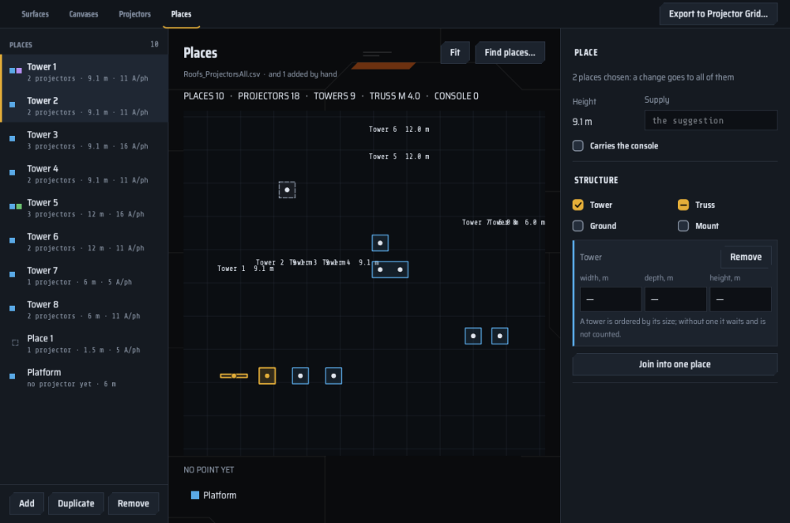

The page has three columns.

- **The list** (left): the places in the order of their pages; drag to change the order. A row has a coloured square for
  each detail (an empty one for a plain place), the name, and *N projectors · height · amps per phase*; the console is
  a tag. Under it: **Add** puts in a place with nothing in it (for a tower that no projector stands on yet: this
  replaces *towers by hand*); **Duplicate** copies the places chosen, with their details and no positions; **Remove**
  (or the Delete key) takes the places chosen away, and a place of the export gives its positions back, to be found again.
- **The plan** (centre): the site from above in metres, a grid every 5 m. Each place is outlined in the colour of its
  first detail (dashed grey when it has none), a truss is a bar, a tower is its footprint (typed or worked out), the
  positions are dots, and the name and height are a label. What is chosen is gold. Click chooses a place, Shift or
  Command adds one; drag a rectangle over the dots to choose positions, and right-click on them for **Move to…** (another
  place) or **Into a new place**. The wheel zooms and **Fit** shows everything. The list, the plan and the tray under
  the plan are one choice. The tray holds the places that have no point yet (towers made by hand). A line of figures
  over the plan counts places, projectors, towers, metres of truss and consoles.
  **Find places…** groups the export's positions again: the distance they stand within, and the **Towers / Trusses**
  switch. It asks first before it forgets places you changed.
- **The inspector** (right): for one place, its name, height (read from its positions; a place with **no positions** has a **Height** box to type, which wins over the size of its tower or ground, and several such places are typed at once), supply, whether it carries the
  console, and **Structure**: four boxes, Tower, Truss, Ground, Mount, each with a card of its fields when it is
  ticked (a tower's width, depth and height; a truss's length, type, hang points and the height it hangs at; a ground
  stack's size; what a mount is on and how it is fixed). **Remove** on a card unticks it. A **tower's size is worked out** when
  nothing is typed: 1 m of width for each position (a stack counts once) made up of Layher Allround bays, the fewest
  that reach it (one position 1.09 m, four 2.07 + 2.07 m, six 3.07 + 3.07 m); a depth of 2.07 m until you type one; the
  highest projector plus 2 m, rounded up to 0.5 m. The figures stand greyed in the empty boxes, a line under them says
  the bays, and the equipment list orders the tower at that size. Type only the depth and the rest is still worked out;
  type a width or a height and the size is yours (what you left empty is taken from what was shown); empty the width
  and the height to have it worked out again. **A projector added by hand** (on the Projectors page, with no
  place in the Venue) is put in a place from its **Positions**: *Add projector by hand…* lists the ones in no place yet;
  it is counted there (projectors, signals, power) at the place's height, listed as *by hand*, and *Take out* lets it go
  again. Renaming the place takes it along; removing the place frees it. Below: the place's positions,
  and its page (the screenshot, the map view, which of them it shows).

**Choose several places** (Shift or Command in the list, or on the plan) and the inspector edits them all: a field where
they differ shows *various* (or *mixed*), a box shows a dash, and what you type or tick goes to every one of them in one
step, which is one Undo. **Join into one place** puts them into the first; **Join into one truss** makes them one place on one truss, *Truss N*, a Truss in place of the Tower, its length measured off the positions; **Split into positions** gives each position a
place.

How positions are first grouped is the **Placement** switch in *Find places…*:

- **Towers**: positions near each other (4 m) stand on one tower, as always.
- **Truss**: projectors hung at one height on one line (within 100 mm), spread along the other axis, are a truss each,
  called *Truss 1*, *Truss 2*… from left to right; whatever hangs on none is found as towers. A truss is not
  scaffolding, so it does not count among the towers.

Positions below 3 m that no tower holds are found as plain places (*Place 1*, *Place 2*…), and get pages like the rest.

Each place gets a page in the Projection Study, with a screenshot or a map view. The equipment list says what the
details come to: a **Scaffolding** sheet (every tower and its size, towers of one size on one row), a **Truss** sheet
(each truss's length, the one you typed or the span of its positions plus 2 m at each end, with the metres in all) and,
in the totals, the ground stacks, the mounts by what they are on, and the places with no structure.

What those pages say is chosen in the **Documents** tab: open the Projection Study and, in its panel on the right,
tick or untick the boxes under **Positions pages show**. All are ticked, and the pages say everything. Untick a box and
every place's page leaves that out, closing up with no gap:

- **What it is**: a line for each detail of the place (scaffolding tower, truss with its length, ground stack, what it is
  mounted on); a plain place says nothing;
- **Size**: the width, depth and height of the place;
- **Projectors and stacks**: how many projectors, on how many positions, and how they are stacked;
- **Model**: the projector models;
- **Signals**: the signal count;
- **Lenses**: the lenses picked for the positions;
- **Height**: the height or heights the projectors hang at;
- **Full output**: the full output in kW;
- **Power**: the amps per phase and the suggested feed;
- **Console**: the line saying the place carries the control position;
- **Screenshot** and **Map view**: the two pictures (a place's own *Its page shows* still applies to what is left).

The choice is for the whole project and is saved in it.

**Export to Projector Grid…** (at the top right) writes a `.pgrid` file for the Projector Grid app:

- one node for every physical projector;
- the towers as groups;
- IP addresses from the subnet you give.

A login and password are typed for that one file and never saved in the project.

---

## 7. Stage and the disguise build

*Preproduction › Stage › Venue* (⌘7) shows the whole job in 3D, exactly where the disguise build will put it:

- the LED screens and walls where the drawing places them;
- the models;
- the export's projectors with the pyramid of their light.

To move around: drag to turn, scroll to come nearer, drag with the middle button (or Shift on the floor) to look
sideways, double-click a thing to go to it. *Front*, *Top* and *Whole venue* set the view.

To change the chosen thing, use its **gizmo**. It has two modes, chosen by *Move* and *Rotate* under the picture (or the
keys W and E): in *Move* drag a red, green or blue **arrow** to move it along disguise's X, Y or Z; in *Rotate* drag a
**ring** to turn it about that axis (Shift: in steps of 10 cm and 15°). The gizmo is as big on the picture as the thing
is, between a small and a large size, so it grows smaller as you draw away. Dragging the thing itself still moves
it on its level (Shift up and down, Option turns it). Its X, Y, Z and the three turns are in the inspector.

**Several things at once.** Choose several in the list with Shift or ⌘, or on the picture with ⌘-click (it adds the thing
under the mouse, or takes it away if it is chosen); the list and the picture are one choice. The gizmo then stands at the
middle of what is chosen. Moving it, or typing X, Y or Z in the inspector, moves all of them; a ring turns all of them
**round the gizmo**: each swings round it and turns by the same angle. One drag is one Undo. The inspector says *N chosen*
and shows a number they share, or *mixed*; typing in a box writes that one number to all of them and leaves the other boxes
alone. What cannot be moved here (a projector: its place comes from the export, from its wall's count or from the model that
carries it) stays where it is while the rest move, and the inspector names it once; if nothing chosen can move there is no
gizmo. A name belongs to one thing, so *Rename…* and F2 do nothing with several; the right button then offers only *Put back*,
for the ones you moved by hand. The LED and Surfaces pages follow a choice of one thing, and are left as they are with
several. *Duplicate* and *Remove* work on one thing at a time here.

**Adding a projector.** *Add › Projector* at the foot of the list puts a new projector at the middle of the venue, 2.5 m up,
aimed at the nearest surface, and chooses it. It is called *Projector 1* (then 2, 3…; rename it like any other) and takes
the body the job already has (the export's most used one, else the one the project names, else the PT-RZ34K). Its
inspector has the **Model** and **Lens**, **X, Y, Z** where it stands, **Aims at X, Y, Z** and **Roll**, all in disguise's
axes as the other things' are. Drag its arrows to move it: its aim goes with it, so the picture slides over the wall;
type **Aims at** to turn it. It is not turned with a ring. Each move or edit is one Undo. *Duplicate* copies it a metre
to the side (with its aim) and *Remove* takes it away. Typing the point it stands on as its aim is refused. With no lens
chosen it is drawn and lit at a throw of 1.6 (the notes say so); a lens makes it the middle of that lens's range.

A projector added this way is **the project's own**: the list marks it *Hand* (the export's say *from the export*), and
importing an export, or another one over it, never changes or removes it. It counts everywhere the export's projectors
do: the surface pages of the Projection Study (coverage and brightness), the places (at 2.5 m it is a plain place; above
3 m a tower, as for the export), the equipment list and its signals (under *By hand*), Projector Grid and the disguise
build. Rows added on the Projectors page, with no place, are unchanged: they stand in a row on the floor of the Venue,
count in the equipment list and are not made in disguise.

To rename a projector of the export, choose it and type in **Name** in the inspector (F2 in the list, or *Rename…* on
the right button, goes there). The name is the project's and is used wherever the projector is named: the study,
Projector Grid and the disguise build. Leave it empty to go back to the export's name; ⌘Z takes a rename back. A
row of projectors added by hand is renamed the same way (in the Venue, or in its **Name** box on the Projectors page) and a name another projector already has is refused; the name reaches the Stage, the study (*called …*) and Projector Grid, and the rebuild note below applies to it too. A projector a wall counts is named by the wall: its count is set on the Surfaces page, so a name would be lost when the count changes.

An LED screen, a wall or a model is renamed the same way (F2, *Rename…*, or **Name**), from the Venue, from the LED
page or from the Surfaces page, and it is **one rename**: the canvases that hold the screen, the link of a wall to its
model, what the Stage shows on it, the content meant for it and the pages taken out of the PDFs all follow, and one
⌘Z takes it all back. A name another screen (or another surface) already has is refused. The disguise project already
built and the files already placed on the servers keep the old name (disguise finds them by name): the window says so
after the rename, so rebuild the disguise project and place the content again.

What stands nowhere (a screen added by hand, a projector by hand) is drawn in a row on the floor, in rust colour. The
screens can show their test pattern or the content placed for them.

**Build disguise project…** (the Stage page's inspector, under *disguise*) builds the screens, surfaces and projectors
in the project open in a running Designer, through its Python API.

- The window opens large (about 900 × 700, less on a small screen) with the list of screens first and taking the room:
  *Check* fills it, a dozen screens show without scrolling, and *All* / *None* above it tick or untick every row. Designer's
  address, the origin, the disguise project folder and the copy options are folded under it in *Options* (closed; click it).
- Each LED screen's grid and each projection surface's test pattern go in as a one-frame Hap Alpha movie (not a PNG),
  laid on its screen or surface.
- *Check* lists what it would do with a tick for each thing: untick what is not to go into disguise; its grid, test
  pattern and layer stay out with it.
- Name the Designer machine there (on Windows it is this computer, *localhost*, unless the project names another).
- The disguise project folder is asked for in this window (*disguise project*, *Choose…*) when none is set, so the
  build works from PreProduction; it is the same setting as the Files page's (section 9), set once for both. Without it
  nothing is copied and a model cannot be made.

---

## 8. Documents and Build

*Preproduction › Documents* (⌘3) shows the three PDFs as a build will write them, drawn from the project as it is now.

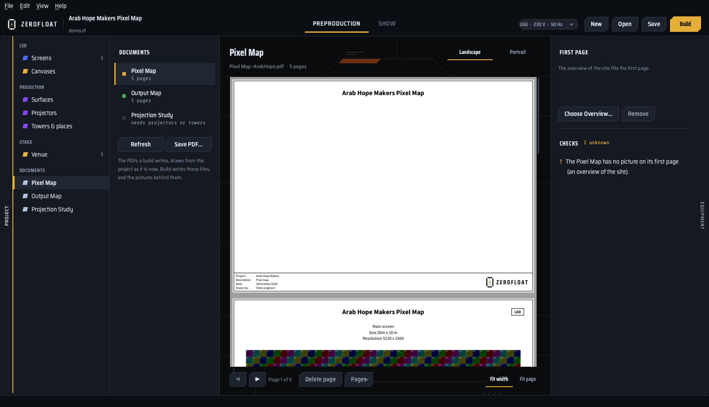

| Document | For | What it holds |
|---|---|---|
| **Pixel Map** | the client and the content makers | a cover, a page for each LED screen and projection surface, the canvases, and the **Content Delivery Specification** as its last page |
| **Output Map** | the crew | how the LED is patched: which output of which server feeds which piece of which screen, then **a page to every output**: its whole raster (3840 × 2160 and so on) as a frame with rulers in pixels, and inside it, where it is set, the part of each screen's grid that goes to that output, with the screen's name and the pixel rectangle of it in the frame and in the screen |
| **Projection Study** | the crew and the client | the projectors, the lenses, the light, the towers and the power plan |

- **Landscape / Portrait** decide how the pages stand. Both are A3.
- **Choose Overview…** puts a picture of the site on the first page.
- **Delete page** removes a page from a document. **Pages** lists every page with a tick: untick one to take it out, tick it to put it back; the list stays open while you tick several.
- **Save PDF…** saves the one shown.

**Build** (⌘B, the gold button) asks what to write and where:

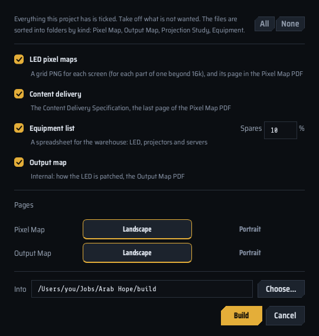

**The Pixel Map is always built**: its ticks (*LED pixel maps*, *Projection test patterns*) are ticked and grey, and the
Content Delivery Specification, the last page of the Pixel Map, has no tick of its own and cannot be taken out with
*Delete page* either.

```
build/
  Pixel Map/          <name> Pixel Map.pdf, Pixel Grids/, Test Patterns/
  Output Map/         <name> Output Map.pdf
  Projection Study/   <name> Projection Study.pdf
  Equipment/          <name> - Equipment.xlsx and .csv
```

**A build never writes over a PDF.** The next one is `<name>_v2.pdf`, then `_v3`. When a folder already holds a
build, *Only the PDFs that changed* leaves the unchanged ones alone.

**The version is on the page too.** The title block at the foot of every page says `Version: v1` for the first file of
a name, `v2` for `<name>_v2.pdf`, and so on, so that a printed page says which file it came from. The preview in the
Documents tab shows no number: it does not know which folder you will build into.

**What changed in the PDFs (round 20).** In the Projection Study, a job whose places are not all towers (trusses, a
wall mount, the ground, no structure) has the page *Projector Positions Overview*, which says `5 (Five) Projector Positions`
and under it how many of each kind; a job of towers alone still has *Scaffolding Towers Overview*. The Projection Equipment
page now says the video signals (HD and 4K), the HDMI matrices and the media servers with their VFC cards. The servers are
counted for the whole job, LED and projection together, so the number is the equipment list's, and a server that serves
both says *shared with LED*. In the Output Map the table of outputs is the **last** page, titled *Output Summary 3840x2160*,
and its *At x, y* column is filled for every output.

Grid and pattern pictures keep their names, because a media server finds them by name. They are rewritten only when
their pixels changed.

### Content check: a file on its screen

*Preproduction › Content check* (⌘9). Before a client's content goes anywhere near the show, look at it here against
the thing it is made for.

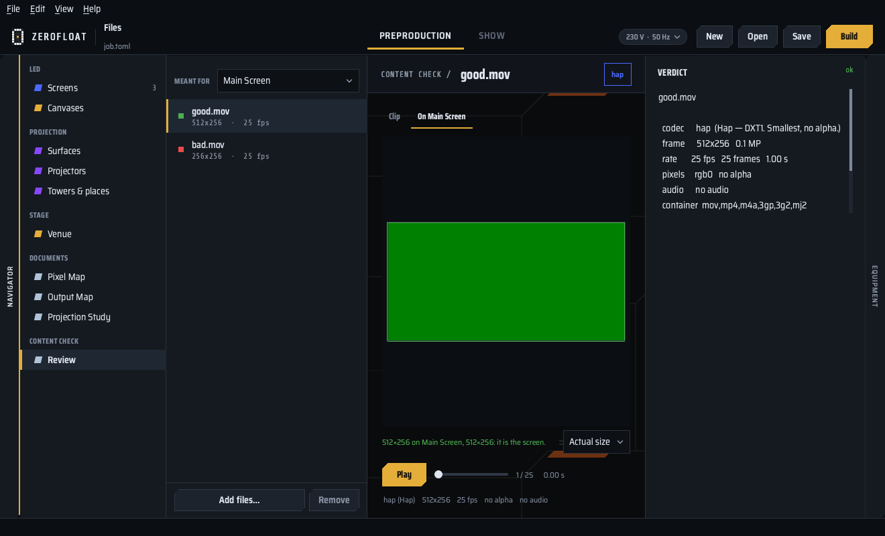

1. Drop a file on the page, or press **Add files…**. It joins the list on the left, for this sitting only: nothing is
   written into the project.
2. Under **Meant for** choose the LED screen, canvas, projection surface or 3D model of the project (a part beyond
   16k too). The file is judged against it, in the **Verdict** on the right: its size against the screen's pixels,
   its frame rate against the mains' (25/50 fps on 50 Hz, 30/60 on 60 Hz), and its codec against what disguise plays
   (Hap, DXV 2, NotchLC). What is wrong comes first, in red.
3. The player in the middle has two views. **Clip** is the file as it is. **On <screen>** puts it on the screen's
   shape: an LED screen as a board of its pixels with its cabinets drawn, a canvas or a flat surface as a plain board,
   and a **3D model** as the model with the file on its unwrap (the UV view), turned with the mouse. The view's box
   says how the file sits on it (*Actual size*, *Fit width*, *Fit height*) and what part of the map it covers.

4. **Transcode** (right, under the Verdict) is here too: choose the file in the list, then the format (Hap, Hap Q, Hap
   Alpha, DXV 2), size, frame rate and sound, and press **Transcode…**. A file written goes to the **Converted** tab
   of the list, beside **Content**, and is judged like any other. It is the same transcode as Incoming's (section 9):
   one line of jobs for both, so a transcode started here waits for one started there, and the *Queue…* window and
   the number of files written at once are shared. (The screenshot above shows the page before the block was back.)

**The equipment list** is one workbook: the servers and the signals they are counted from, the LED, the projection
(projectors, lenses, towers, scaffolding) and the electrics, with the spares you ask for.

---

## 9. Incoming: content into the show

*Show › Files › Incoming* (⌘4).

**The first time** the Show half is opened on a project, it asks for two folders. Both can be changed later on this
page.

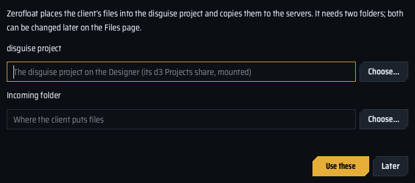

- **The disguise project**: the folder on the Designer that holds the `.d3` and `objects/`, reached through its
  `d3 Projects` share mounted on this Mac.
- **The incoming folder**: where the client puts files. Usually on this Mac.

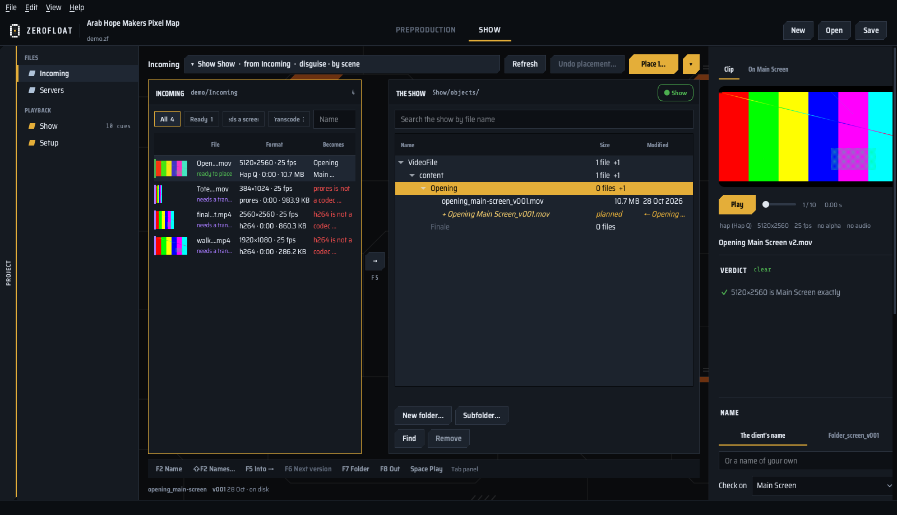

**Two panels.**

- **Incoming** on the left: what arrived. Each row shows a thumbnail, the format, and what the file becomes.
- **The show** on the right: the disguise project's own folders under `objects/`, as a tree. The pill at the top
  right says whether the share can be placed into: green, amber while it is read, red when it cannot.

The panel with the keyboard is framed in gold, and **Tab** moves between them.

**What each row says.**

| State | Meaning |
|---|---|
| **ready to place** | disguise plays it, and it knows its screen |
| **needs a screen** | the name did not say which screen; choose it in the inspector |
| **needs a transcode** | disguise will not play it (H.264, ProRes, a NotchLC file whose frames change between alpha and none…) |

**Why a transcode.** A row that needs one says why under its name, and in its tooltip, the inspector, the Place window
and the transcode window: for a NotchLC file whose frames lose or gain alpha, the frame and the second where it changes,
for example «frames 0–431 have none, from frame 432 (17.28 s) they have alpha … disguise stops reading such a file …
transcode to Hap Alpha to play it».

**The player** is a pane under the two panels (**Space** plays or pauses). It has **Clip** and **On <screen>**
views, and **Fold ▾** puts it away until it is wanted (a folded player does not hold the file open). It lets go of
the file before Place moves it. It takes about three fifths as much room as the two panels (drag the bar between
them: the size is remembered), and a **double click on the picture** opens it in a window of its own.

While files are placed, the progress has a line of its own across both panels: a thin bar, and under it what is being
placed, how many of how many, and the size.

The inspector on the right gives the **Verdict** (one to three lines high, as long as its text), then **disguise clip
cropping**: the clip type disguise should give the file (Fit, Stretch, Pixel perfect…). It also sets **Name** (*the client's name*, or the convention
`<scene>_<screen>_v001`), the screen it is checked on, and the clip type disguise should give it (Fit, Stretch, Pixel
perfect…).

**Putting files where they go.**

- Drag rows onto a folder of the show, or choose a folder and press **→** or **F5**.
- Drag a row onto a file of the show to make it **that file's next version**: it takes that file's name, one version
  higher. **F6** does the same.
- What Place would add is drawn in **gold** in its folder (`+ name`, *planned*).

| Key | Does |
|---|---|
| **F2** | a name of your own for the file |
| **⇧F2** | names for many files by a pattern: `[N]` the file's name, `[C]` a counter, find and replace, case |
| **F5** | into the folder chosen on the right |
| **F6** | the next version of the file chosen on the right |
| **F7** | a new folder in the show |
| **F8** | leave the file out (or take it back in) |
| **Space** | play or pause |

**Place…** shows every copy before anything is written. Then:

1. A file disguise cannot play is **transcoded first**:
   - Hap Q by default, or Hap Alpha for a picture or a source with alpha;
   - Hap, Hap Alpha or DXV 2 if you choose;
   - a source that says it has alpha is not written in a format without it unless you tick **Drop the alpha**: right
     when its alpha is solid (NotchLC often says alpha where every pixel is opaque), wrong where it cuts the picture
     out;
   - its sound goes to a WAV in `AudioFile/`, stays inside the movie, or is left out (*No sound*), as the transcode
     settings say; the player's own transcode has a *No sound* box too.
2. Every copy is checked against its source.
3. A file already in the show is left out.
4. The client's file is moved into `Placed/` inside the incoming folder. **A source is never deleted.**

**The window does not close while it places.** Asked to close, it offers *Close When Placed* (it goes by itself when
the last file is in), *Stop and Close* (the file being copied is taken away again, what was placed before it stays and
can be undone) or Cancel. A copy cut half way would leave half a file in the show.

Place's arrow offers more:

- **Place, then copy to the servers…**: the copy of section 10 follows straight after.
- **Undo placement…** walks the last placement back. A file changed since is kept.
- **Purge this Mac's copy…**: with *Keep a copy on this Mac* ticked, the placed files are kept here too. Purge removes
  them only once the Designer and **every** server hold the same file at the same size.

**The folder template** (left rail) decides the layout of `content/` and the names: *disguise · by scene*, *by screen*,
*by scene and screen*, *flat*, *by delivery date*. **Folders in Content…** previews the folders and makes them.

**Nothing in the show is ever renamed.** Only the arriving file is named, as it enters.

---

## 10. Delivery: the copy to every machine

*Show › Files › Delivery* (⌘8). The page was called *Servers* until the Machines page was added.

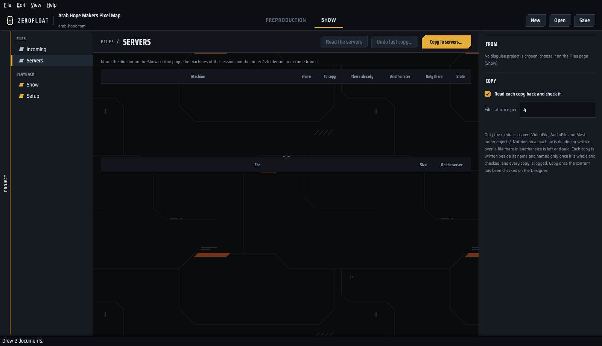

The director must be named on the Setup page first (section 12).

**Read the servers** asks the director which machines the session has and where the project is on them. It then opens
each machine's `d3 Projects` share as a guest and lists, for each machine:

- what would be copied (*To copy*);
- what is there already;
- what is there in *Another size*;
- what *Only* that machine has.

**Copy to servers…** shows a summary and then copies to every machine at once.

- Only the media is copied: `VideoFile`, `AudioFile` and `Mesh` under `objects/`.
- **Nothing on a machine is deleted or written over.** A file there in another size is left and named for you to look
  at.
- Each copy is written under a temporary name and renamed only when it is whole and checked. With *Read each copy
  back and check it* on, it is read back too.
- Each machine's free space is checked before the copy starts.
- *Files at once per machine* (1 to 6) sets the speed. 4 suits a 10 Gbit network. A machine is written the next file
  while the last one is read back.
- **Speed test** (under *Network*, once the servers are read) writes 1 GB to each machine, reads it back and removes
  it, and says how fast each link is both ways.

**Undo last copy…** removes what the last copy wrote, if it is unchanged. **Remove leftover parts…** clears pieces an
interrupted copy left. The button is always there: before a read it says *Leftover parts* (read the servers first), and with nothing
to clear *No leftover parts*; both greyed.

Copy once the content has been checked on the Designer.

### Only on the machines, and Remove through disguise…

Below the two tables, **Only on the machines** lists what a machine of the session holds under the show's `objects/`
that the show does not: the file, its size, the machine and **why it is extra**. After every read, Delivery asks each
machine itself (disguise's own service, at the address the Machines page found it at) which media it holds and
compares it with the Designer's project.

- *an older version: the show holds v003* is a `_v002` of a name the show has newer;
- *not in the show* is any other file the show does not have;
- gold **and not in Zerofloat's copy log** says that Zerofloat did not put the file there (someone else did).

A version **newer** than the show's is never listed (it is counted in the line under the table): it may be the one the
show is about to play. A machine that does not answer is named in the same line.

Tick the files and press **Remove through disguise…** (nothing is ticked at first). Before anything is sent it asks, and the
question names the machines and the files (the count and the first few), says that **disguise lets Designer go of each
file, even one a layer is playing, and deletes it from the machine's disk: it is not put in a bin and cannot be brought
back from here**, and says separately how many of the files are not in Zerofloat's copy log. Each file is removed by the
machine's own disguise, and the table is read again. A file already gone is said to be so. A file outside the project's
`objects/` folder is never sent, whatever is ticked. *Undo last copy…* and *Remove leftover parts…* still work on the
share; going through disguise when a file is busy is the next step.

### Machines on the network

Finding the machines, their roles and the project folder moved to the **Machines** page (section 10a). This page
works on the machines the director's session has.

---

## 10a. Machines: the disguise machines on the network

*Show › Session › Machines* (View › Machines).

The page finds the disguise machines by their addresses, even before they are in a session, and says what state they
are in.

- Type the addresses beside *Machines on the network* and press **Find machines** (or **Read again**): one address, a
  range of the last number (`192.168.10.101-110`), a network (`192.168.10.0/24`) or a machine's name, apart by
  commas. They are kept on this computer for the next time. Finding only reads.
- Each machine found is a row: a tick, its name and address, its role in the director's session, its type, its
  Designer version (**red, with the director's version, when it differs from the director's**), the project it runs,
  its health (a lamp, the frame rate and the frames dropped), and whether it has the show's project folder (*there*,
  *missing*, *not known*), with **behind the director** when its copy of the show's project was saved before the
  director's. The table never scrolls sideways: in a narrow window the least important columns shrink and their text is
  cut, and a tooltip says all of it. The director's row has no menu: it keeps its role.
- Choose *Actor* or *Understudy* in the *Role* column (a changed one is marked *not applied yet*), then
  **Apply roles…**: the question lists every machine whose role changes, and a machine set to *—* leaves the
  session. The director stays the director.
- **Copy project folder…** copies the Designer's project folder, whole, to every machine that lacks it, as
  `d3 Projects/<folder>`. A machine that already has the folder is left alone. The copy is checked, logged and undone
  like the media copy, and its free space is checked first.
- **Save on the director…** saves the director's project, so that the roles are kept.
- Tick machines, then **Start in the session…** (starts the director's project on each ticked machine whose Designer
  is not running; it joins in its role in 10 to 20 seconds), **Quit…**, **Restart…** (back in 25 to 30 seconds) or
  **Force quit…** (ends Designer at once: unsaved work is lost). Each asks first and names the machines. The director
  is in a quit or restart only when its own row is ticked, and the question then says that the session ends with it.
  Press *Find machines* again to see the result.
- **Health** is read when the machines are found, and while the Machines page is open the frame rate follows over
  Live Update and the rest is read again about every 10 seconds; it stops when you leave the page. A lamp is *green* (all
  well), *gold* (a state needs a look, a notification, or frames dropped or missed are still growing), *red* (a state is
  bad) or *grey* (nothing read: Designer is not running there, or the director does not answer; the tooltip says
  which). The strip above names the worst machine and why. Frames dropped *since the project started* are history and
  do not warn by themselves.
- At the right, the chosen machine:
  - **Machine**: Windows and image, VFC cards, GPU outputs, network adapters; «none reported» for a PC.
  - **Outputs**: what the machine reports for each output (resolution and refresh) beside what the project's Output
    Map expects of it, *same*, *differs: refresh*, *missing*, or *extra*. The project has no record of which machine is
    which server, so the actors are matched **by order** (the first actor in the table to the first server of the Output
    Map, and so on) and the tab says so. A PC reports no outputs: the expected ones are shown and the tab says that
    nothing was reported. Nothing is changed from here.
  - **Projects**: its projects, when each was saved and by which Designer, the one opened last, the show's marked.
  - **Health**: the lamp, the frame rate, the frames dropped and missed and whether they are growing, the states by
    kind (Connection, Output, Genlock, Devices) with their severity, what is wrong in words, and Designer's notifications.
  - **Media**: what the machine holds under the show's `objects/` against the show, as counts and a list: *missing*,
    *another size*, *extra* and why. It only reads; **Show on Delivery** goes to the page that copies and removes.

With one understudy there is nothing more to set: it covers any machine that fails. With several, which machines each
one covers is set in Designer. This was tried on one show (Palm Springs, Designer r34.2.3). Force quit was not tried on a real machine.

---

## 10a. Timeline: the running order

*Show › Playback › Timeline*.

The show's running order as **blocks**: a block is a scene, with one clip on each screen of the project, and the next
block starts where the last ends. Here it is drawn and kept in the project file; the gold **Send to Designer…** button
builds it in disguise Designer as layers on a track (below). The button is off when there is no timeline or something
in it is wrong; its tooltip says what.

- **Timelines** (left): a project may hold several. *Add*, *Duplicate* and *Remove* are at the foot.
- **Blocks** (middle): grip, number, scene, start, duration, cue tag, split and a word on what is missing. Drag a row by
  its grip to move it. *Add scene…* offers the scenes found in the show's `objects/VideoFile` (files named
  `<scene>_<screen>_v001`) and makes a block with each screen's newest file; if the project has no show folder
  it says so, and the show is chosen on the Files page. *Add clip…* puts one file on a screen of the chosen block.
- **The drawing** (below): a ruler in track time, the blocks as sections, a gold flag for each cue tag, and a lane for
  each screen. A bar is a clip; a hatched bar is a clip shorter than its block, held to the block's end by *At end
  point*; a bar of another colour is a still, for the whole block; a dashed red slot is a screen with no clip (it is
  not an error: no layer is made there). A vertical line is a split. Click a block to choose it; nothing is dragged
  in the drawing. **−**, **+** and **Fit** zoom it; the wheel moves it when it is zoomed.
- **Inspector**: *Block* (scene name, a card for each screen with its file and length, *Fit to contents* or a typed
  length, Mode, At end point, Split, Cue tag, the timecode tag, a note) and *Timeline* (name; what it builds on: the
  open track after its last layer, a track from a time, or a new track; the defaults for new blocks, which a block
  follows until it is changed; cue numbering and the timecode at the track's start; the Designer's address).
  Choosing in a block what the timeline already says writes nothing.

Every change can be undone with ⌘Z. The line over the table says what is wrong (two blocks of one name, a missing
start time) in words.

### Send to Designer

*Send to Designer…* opens a window that first **reads** and only then **makes**.

- **Editor address**: the Designer to send to (the timeline's *Editor* address, else the Files page's). An address
  typed here is kept as the timeline's Editor. Under it is the machine's line: its name, role (solo, director, editor),
  the Designer version, the project open in it, and whether its transport plays.
- **Check** asks Designer and changes nothing. The tree shows what sending would do: **Will be made**, **Not ready**
  (Designer has not read the file yet, or could not), **No clip** (a screen the block leaves empty) and **Already
  there, left as it is**. A block is a branch, its layers are under it with the screen, the layer's name, where it
  starts and how long it is, as timecode on the track. If the machine is the director of a session and its transport
  is playing, the window says so in red and shows nothing: stop the transport, or send to an independent editor.
- **Untick a block** to leave it, with its layers, out of what is sent (the others keep their places); **All** and
  **None** tick them all or none. **Save the disguise project after** is on by default.
- **Apply** is on only after a Check of this timeline and this address, and only when something ticked is to be made.
  It sends blocks a chunk at a time and says which. If a chunk fails, Designer undoes that chunk whole; the blocks of
  the chunks before it stay made (unsaved) and the window names them, the failed ones and those not tried. After an
  Apply, Check again.
- **After a send that made everything, the timeline remembers the track and the time.** Its *Build on* becomes *A
  track, from a time*, with the track it was built on and the time it started at, so that a second Send finds its
  layers and adds only what is missing, instead of building everything again at the end of the track. It is one undo
  step (⌘Z puts the old target back). A new timeline starts on the first choice again.
- **Close** waits while Designer is being asked; the window does not close under a Check or an Apply.

## 11. Show: cues and GO

*Show › Playback › Show* (⌘5). This is the page to look at during the show.

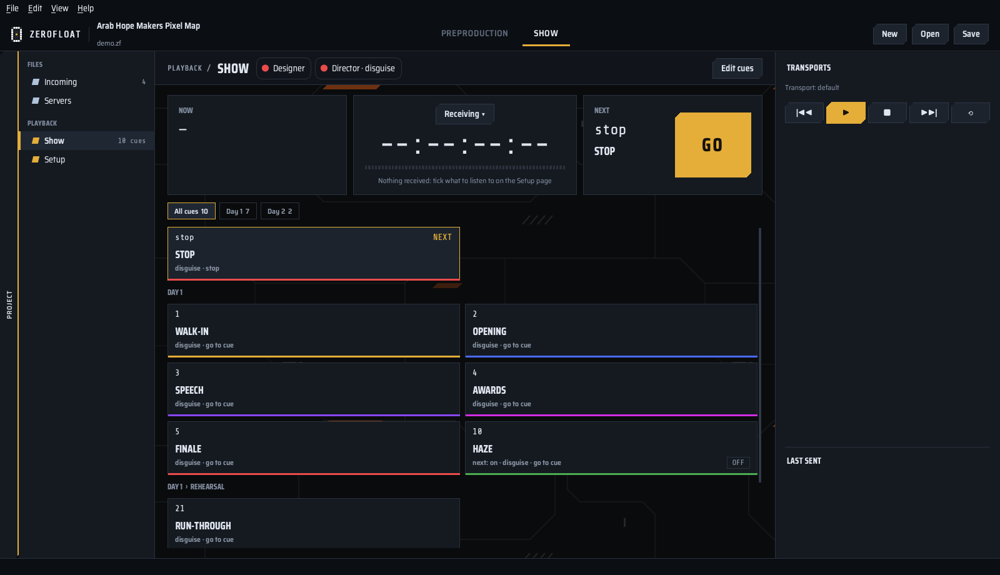

- **The lights** at the top: one for the Designer and one for the director. Green answers within 4 s, amber within 10,
  red after.
- **NOW · the clock · NEXT · GO.**
  - **GO** (or **Space**) sends the next cue.
  - The clock shows the timecode received or the timecode this program generates; the button over it chooses which.
    A third choice on the same button, **disguise**, shows disguise's own timecode (the one its transport reads), big,
    with a line under it that is always there: the timecode type, what disguise says it is doing (*Chasing
    timecode*) and **Engaged** or **Not engaged** (not engaged is shown in the warning colour). With more than one
    transport followed, the lead's is big and each other has a line of its own.
- **The cues** fill the page: NOW is gold, NEXT is outlined. Click a cue to send it.
- **Transports** on the right: a card for each transport disguise has, with its track, section, mode and position, and
  its buttons: previous section, play, stop, next section, return to start.
  - The **star** on a card makes the big countdown follow that transport.
  - **Hide** takes a card out of sight.
- **Last sent** lists what went, and what came back.

**A cue moves the show on only once it has gone.** If disguise refuses it, the reason is said and NEXT stays where it
was.

**Groups.** The cues are kept in groups, up to four deep (for example *Day 1 › Evening › Concert*).

- The line over the cues picks the group shown; *All cues* shows everything.
- **GO goes through the group shown and stops at its end.** It never runs on into the next group; start that group by
  pressing its first cue.
- A **pinned** group is shown over the others whatever group is open, in a blue frame. Its cues are pressed by hand and
  do not move GO.
- The **+** at the end of a line of groups adds a group there. Drag a group onto another to put it inside it, or onto
  *All cues* to bring it back to the top.

**The countdown** on the right says the section playing now (*NOW: …*), what comes next on the track and, when a video
layer plays, how long until the end of that video.

**Lock cues** (beside *Edit cues*): while it is on, a click, GO, the Buttons module and OSC send nothing; what was
pressed is written in the log. If the window ever hangs, a press in Buttons is still sent.

**A latch** is a cue with two halves, ON and OFF (for example haze on and haze off). Each press sends the other half.

**Edit cues** turns the page into an editor. A click then edits a cue instead of sending it:

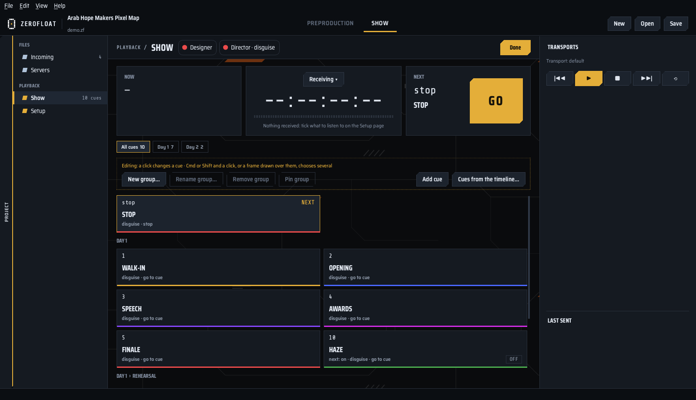

- **Add cue**: a disguise cue number, or a transport command:
  - play, play section, loop, stop, return to start, next or previous section;
  - go to a time, a timecode or a track;
  - brightness, volume.

  Choose its destination and colour (a row of swatches), and its second half if it is a latch. A new destination is
  disguise's Session API or a TimeCore; OSC and MultiTransport destinations of older projects still work.
- **A cue to a TimeCore** is a **Timecode cue**: type the time it lands on (`01:00:00:00`). Off, **Preroll** puts the
  clock exactly at that time; ticked, choose **3 s**, **5 s** or **Custom** (your own number of seconds), and the clock
  starts that much earlier (01:00:00:00 with 5 s starts at 00:59:55:00). GO sets the clock and runs it at once, even if
  it was already running. Then, Player, Track and Transition are disguise's and are not shown. Start, pause, stop,
  restart and set are still in *Sends* for a button that does only that.
- **Cues from the timeline…**: a tree of transport › track › CUE tag, read from disguise. Tick what you want, and one
  cue is made for each tag.
- **New group…, Rename group…, Remove group, Pin group.**
- **Play** (a row of the cue form, for disguise's destinations: Session API, OSC, MultiTransport) says what the jump
  does with the transport once it has gone: **Play to end of section** (what a new cue has), **Play**, **Loop
  section**, **Don't play** (jump and leave the transport as it was; a MultiTransport has no jump without a play, so
  it still plays to the end of the section) or **Stop** (older files). A TimeCore's cue has no such row.
- ⌘-click and Shift-click choose several cues, or draw a frame over them. Then **Move N cues to group**, **Play ▾**
  (the same choices, set on all of them at once; TimeCore cues and cues that are no jump are skipped, and the status
  line says how many) or **Remove N cues** (Delete). ⌘Z puts them back, the whole change in one step.

Press **Done** to go back to the show.

---

## 12. Setup: what the show talks to

*Show › Playback › Setup* (⌘6). Set once a job.

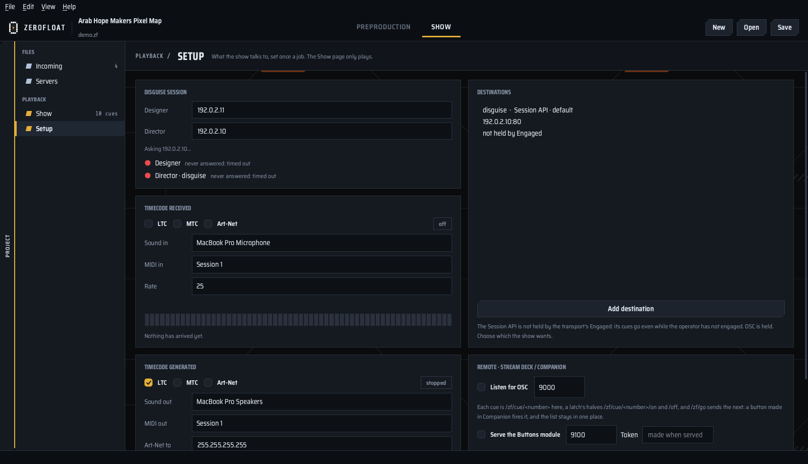

**disguise session.**

- **Designer** is the editor machine: the files and the project.
- **Director** is the machine that runs the show: the live commands, the transports and the Live Update.

The lights under them say whether each answers.

**Destinations** are where cues go. **Add destination** offers four kinds:

| Kind | Note |
|---|---|
| **Session API** | disguise's own HTTP API on the director, port 80. Answers each cue, so a refusal comes back with its reason. **Not held by the transport's Engaged**: its cues go even while the operator has not engaged |
| **OSC** | to an OSC device in the disguise project. Ignored by disguise until the transport is engaged |
| **MultiTransport** | disguise's MultiTransport Manager |
| **TimeCore** | a Visual Productions TimeCore: a timecode cue (its clock set, with a preroll, and run), or start, pause, stop, restart, set. It has no transport, so the *Transport* row is shown for the Session API only |

**Timecode received.** Tick **LTC** (a sound input), **MTC** (a MIDI input, network MIDI included) or **Art-Net**, and
choose the rate. The bar shows whether it runs steadily. Two sources ticked are a clock each, and the Show page's clock
button chooses which one is shown.

**Timecode generated.** Tick LTC, MTC or Art-Net, choose the outputs and *Start at*. Start, Stop and Go to are under
the clock on the Show page while it generates.

On Windows MIDI is not reached yet: MTC is switched off there, and timecode goes as LTC or Art-Net.

**Remote: Stream Deck / Companion.**

- **Listen for OSC** (port 9000): `/zf/cue/<number>` sends a cue, `/zf/cue/<number>/on` and `/off` the halves of a
  latch, and `/zf/go` sends the next.
- **Serve the Buttons module** (port 9100): see section 13.

---

## 13. Bitfocus Buttons and Companion

The DMG's `Buttons module/zerofloat` is a module for Bitfocus Buttons and Companion. With it, the show's cues become
buttons that stay in step with the Show page.

1. In Zerofloat: *Setup › Remote*, tick **Serve the Buttons module**.
2. In Buttons: *Settings › Developer*, import the `zerofloat` folder as a module, and add a connection of it.
3. In the connection, type the Mac's address and the port (9100). There is no token: any machine that can reach the
   port can press GO, so serve it on the show's own network.

**Presets.** Each group of cues is a category of presets.

- With the connection's *Preset Mode* on **Popover**, a group dragged onto a position becomes one button that opens
  over the others with its cues.
- *GO and transport* has GO (with the next cue's name), NOW, the countdown and the transport buttons.

**Lights.** NOW is gold, NEXT is gold text, a latch that is ON is green, and a cue whose destination is missing is
red. A cue's button has the cue's colour and its name, and both change on the button when they change in Zerofloat
(module 1.1.0: import it again after updating).

**Variables.** `now`, `next`, `countdown`, `section`, `group`, the same for each transport, and for each cue
`cue_<number>_name` and `cue_<number>_countdown` (cue 1.2 is `cue_1_2`).

When cues are added in Zerofloat, drag the group onto the buttons again. A press on a button is a press on the Show
page.

---

## 14. Updates

About half a minute after the program starts, and every six hours after that, Zerofloat looks for a new version. You
can also check yourself with *Help › Check for Updates…*, which answers at once wherever you are: the status bar
says it is checking, and then a small window says *Zerofloat x.y.z is up to date*, offers *Version x.y.z is available*
with **Install** or **Later**, or says in words why it could not look.

1. A new version downloads in the background.
2. Its signature and checksum are checked.
3. A bar offers **Restart now** or **Later**. *Later* installs it when you quit.

**An update is never installed during a show.** It waits while a transport is playing, timecode is going out, or a
placement, a copy to the servers, a transcode, a build or a render is running.

*Help › About Zerofloat* shows the version, the build, who made the program (Konstantin Laptev, konstantinlaptev.pro)
and when the last check was made.

**The Windows installer.** A release for Windows has two files: the zip (what updates install from) and
`Zerofloat-<version>-Setup.exe`, a normal installer for people. It needs no administrator: it puts the program in
`%LOCALAPPDATA%\Programs\Zerofloat`, adds a Start menu entry (and a desktop shortcut if you tick it), makes `.zf`
files open in Zerofloat, and adds Zerofloat to *Settings › Apps* for removal. Updates keep working on a copy it
installed: they replace the folder as before and keep the uninstaller.

---

## 15. Keyboard shortcuts

As a Mac writes them; on Windows **Ctrl** stands for **⌘** and **Shift** for **⇧** (Ctrl+N, Ctrl+Shift+S, …).

| Keys | Does |
|---|---|
| ⌘N / ⌘O / ⌘S / ⇧⌘S | New, Open, Save, Save As |
| ⌘B | Build |
| ⌘, | Preferences (on Windows, where this key is free: Project Settings) |
| ⇧⌘, | Project Settings (on a Mac) |
| ⇧⌘I | Import from Mapping Matter |
| ⇧⌘O | Add files to Incoming |
| ⌘Z / ⇧⌘Z | Undo / Redo |
| ⌘D | Duplicate the chosen screen or surface |
| ⌘1 … ⌘9 | LED, Projection, Documents, Files, Show, Setup, Stage, Delivery, Content check (Machines has no key) |
| ⌘0 | the project tree |
| ⌘E | the equipment panel |
| Space | GO on the Show page; play or pause in Incoming |
| F2, ⇧F2, F5, F6, F7, F8, Tab | Incoming (section 9) |

---

## 16. When something goes wrong

- **"Zerofloat cannot be opened because the developer cannot be verified"** (Mac) or **"Windows protected your
  PC"** (Windows). See the first opening in section 1.
- **A DWG does not open.** Install the ODA File Converter (section 1).
- **The show's pill is red, or Place is refused.** The disguise project's share is not reached or cannot be written
  to. On a Mac, mount `d3 Projects` from the Designer in Finder; on Windows, open `\\<designer>\d3 Projects` in
  Explorer. Then choose the project folder again on the Files page.
- **A file is "needs a transcode".** disguise does not play it. Place transcodes it into Hap; you do not have to do it
  elsewhere.
- **"Resource busy" while placing.** disguise is reading the file that was just put there. The program waits for it,
  up to three minutes.
- **The lights on Setup are red.** The address is wrong, the machine is off, or this computer is on another network. The
  Session API answers on port 80 of the director.
- **A cue is drawn with *no destination* in red.** The destination it names was removed. Edit the cue and choose
  another.
- **Feedback.** Tell the person who gave you the program, with the version from *Help › About Zerofloat* and what you
  did. Never send a client's project or content.

## Venue: curved surfaces and where a projector looks

Choose a curved surface in the Venue and its circle appears on the floor with three kinds of handle, as in Surfaces › Top: drag
the centre for the radius (an arc keeps its width), an end of an arc for its angle, a cylinder's seam to turn the canvas. One drag
is one step of Undo. For a projector added by hand, *Aim at* in the inspector lists the project's surfaces and LED screens and
aims it at the middle of the one you pick (a curved surface: the middle of its arc); *Aim with the mouse* waits for your next
click on a screen, surface or model in the 3D view and aims at that point. Esc cancels.
